# M-VAVE FM-1 — Vintage Laser-Cut Synth Case

| Working Prototype with Screen Running | Final Prototype Side Profile | OpenSCAD 3D Assembly |
| :---: | :---: | :---: |
| 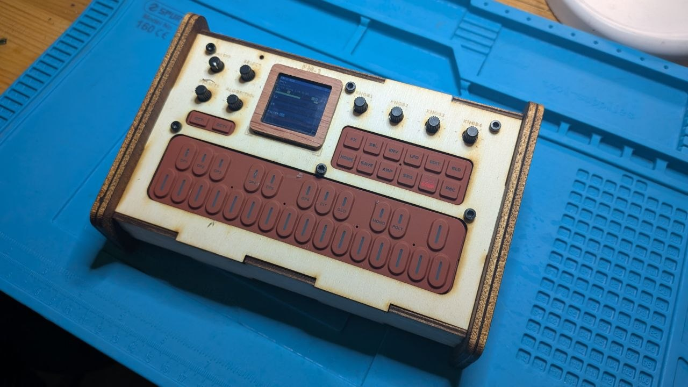 | 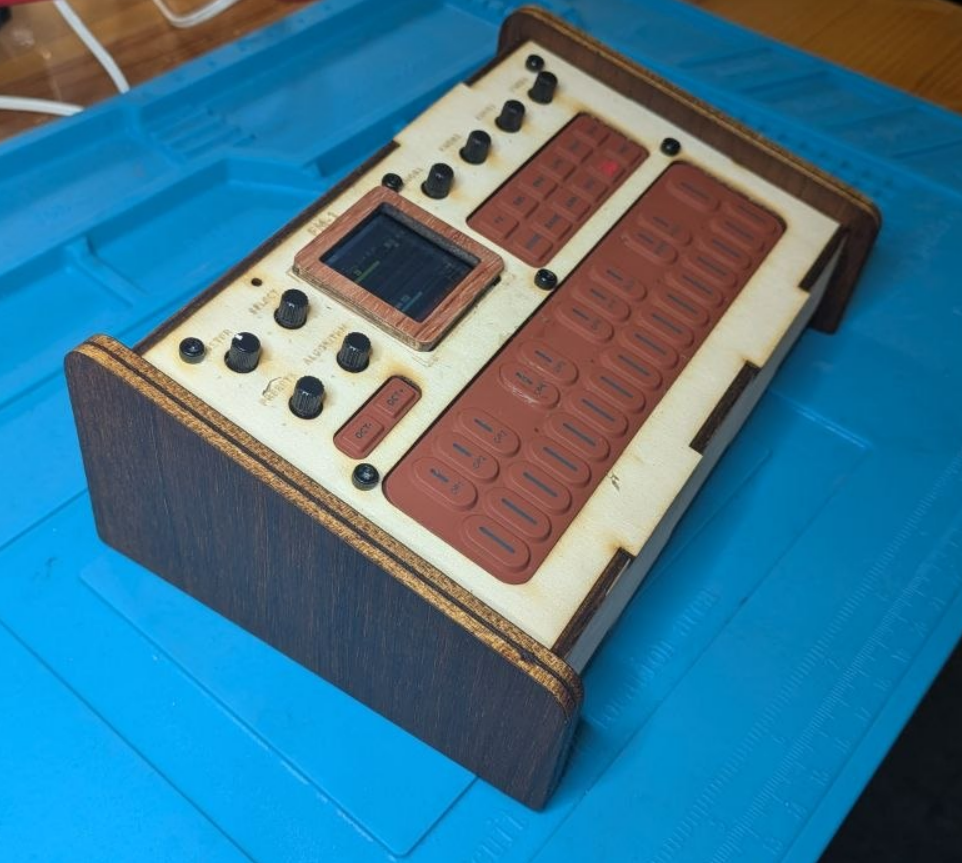 | 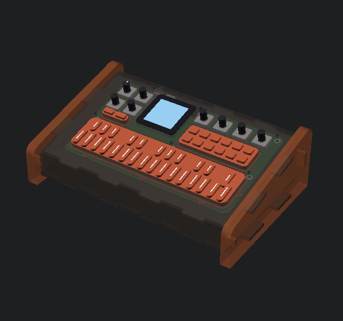 |

**Parametric OpenSCAD laser-cut enclosure with tilted faceplate and vintage wooden side cheeks for the [M-VAVE (Cuvave) FM-1](https://www.cuvave.com/product?id=fm-1) 6-operator pocket FM synthesizer.**

---

## Overview

The **M-VAVE FM-1** is a compact 6-operator FM synthesizer inspired by the classic Yamaha DX7, packed with a 27-key silicone keyboard, 8 endless rotary encoders, a 1.54" IPS LCD screen, built-in speaker, and rechargeable LiPo battery — housed in a bright orange injection-molded plastic shell.

This repository replaces the stock plastic shell with a **customizable vintage-style laser-cut desktop enclosure** ([`fm1_lasercut_case.scad`](fm1_lasercut_case.scad)), inspired by the classic tilted synth cheek aesthetic of the **ABK-20** and **eurorack2chistli** cases. It includes a full **3D internal hardware model** ([`fm1_pcb_and_silicone.scad`](fm1_pcb_and_silicone.scad)) of the PCB, silicone pads, encoders, screen, rear ports, and LiPo battery to verify clearances and alignment in real time.

| First Laser-Cut Frontplate Test | Calibrated Rear Panel Ports |
| :---: | :---: |
| 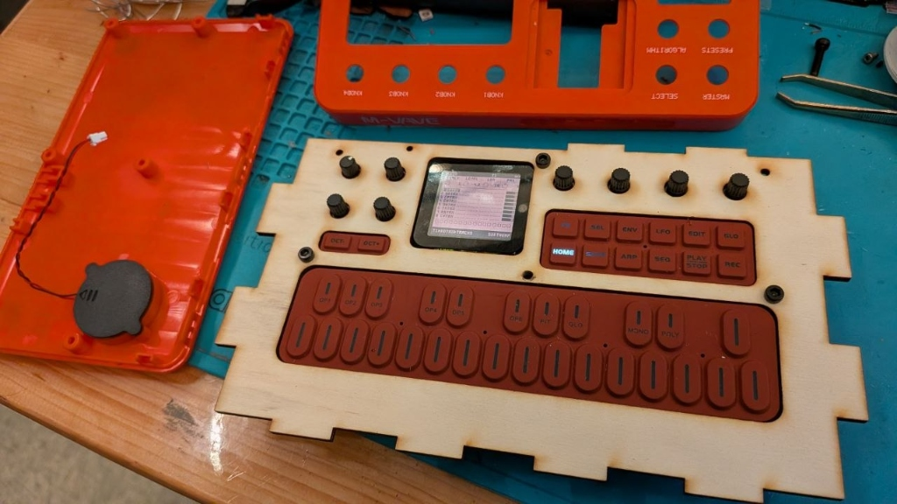 | 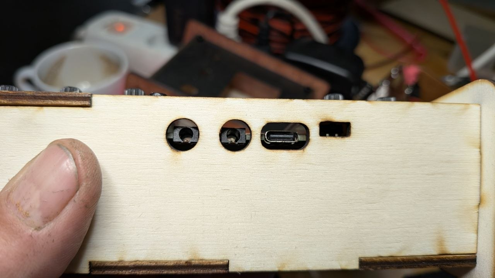 |

---

## Source of the 3D Reference Models

Before opening and measuring the hardware, the exact X/Y control positions of the front panel elements were extracted from the community 3D scan and CAD reconstruction of the stock M-VAVE FM-1:

* **3D Scan & CAD Model Source:** [**M-Vave FM-1 by Zande Creates on GrabCAD**](https://grabcad.com/library/m-vave-fm-1-1)
  * Created using a **Revopoint 3D scanner** and caliper measurements (`F:\Revopoint\FM1\FM1.stp`).
  * Stored locally in [`downloaded/3d_model_grabcad/`](downloaded/3d_model_grabcad/) (`FM1.stp` and `FM1.obj`, `901,951` vertices across 19 named sub-meshes: `Screen`, `Oct_Buttons`, `Options`, `Keys`, `Master_Knob`, `Select_Knob`, `Presets_Knob`, `Algorithm_Knob`, `Knob_1`–`Knob_4`, `Power_Switch`, `Tray`, `Body`, `Foot`, `Speaker`, and `Light_Cap`).
* **Official Product Specs & Manual:** [**Cuvave / M-VAVE FM-1 Official Product Page**](https://www.cuvave.com/product?id=fm-1) (archived in [`downloaded/official_cuvave/`](downloaded/official_cuvave/)).

| GrabCAD Reference Render (`downloaded/3d_model_grabcad/FM1.png`) | Reconstructed 3D PCB & Silicone Assembly (`fm1_pcb_and_silicone.scad`) |
| :---: | :---: |
| 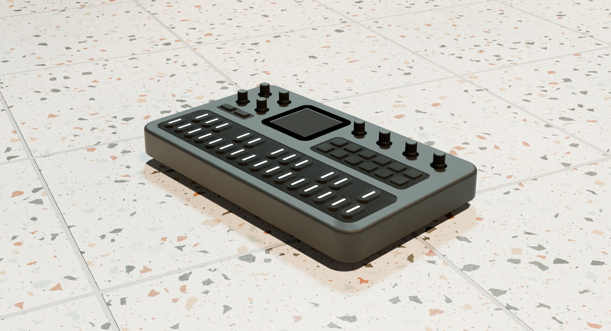 | 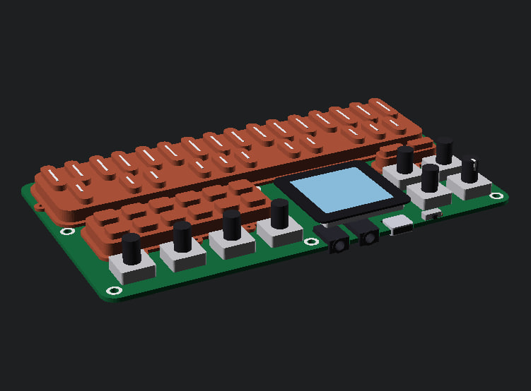 |

---

## Teardown & Reverse-Engineering Process

### 1. Disassembly & Screen Ribbon Cable Warning

> [!CAUTION]
> **Be careful with the 1.54" TFT screen and its FPC connector (`J12`)!**
> In the stock plastic enclosure, the glass display is glued into the orange top shell while its flexible ribbon cable is plugged into `J12` on the main PCB. Unlock the tiny black plastic FPC latch gently before pulling the ribbon, and pry the glued screen out slowly so you do not snap the black latch or tear the flex cable.

| 10-Pin Screen FPC Connector (`J12`) | Fragile Black FPC Latch | Careful Screen Removal & Test Fit |
| :---: | :---: | :---: |
| 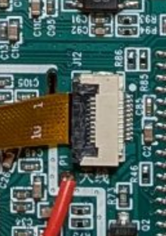 | 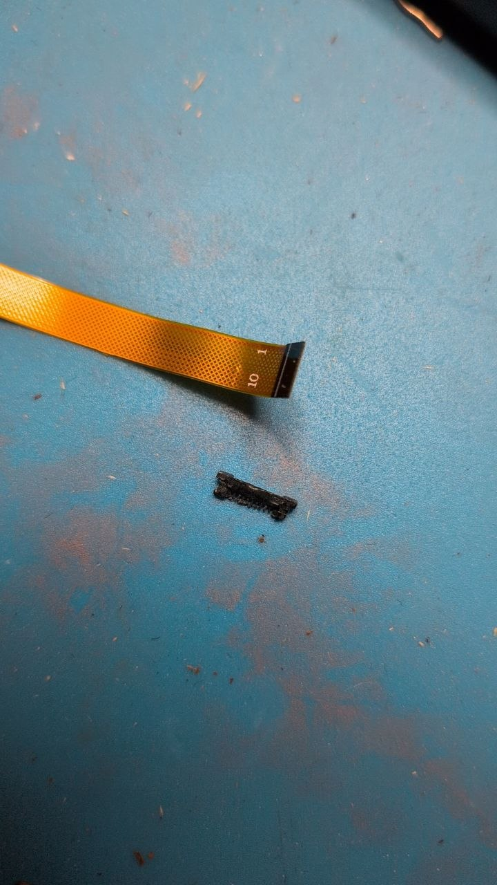 | 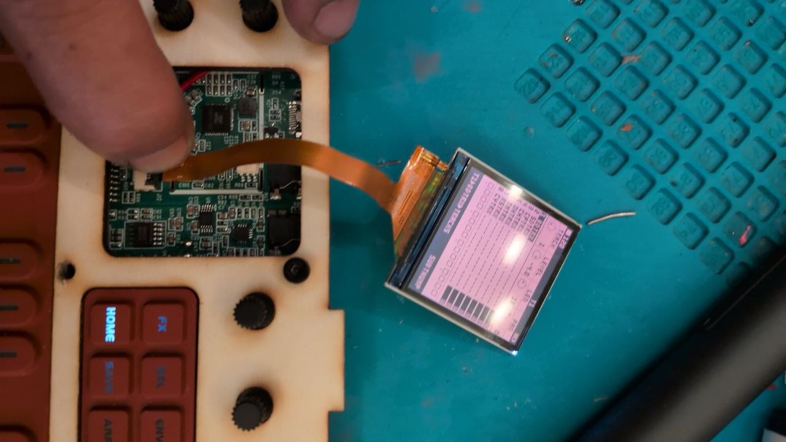 |

---

### 2. Measuring the PCB, Silicone Pads & Internal Stackup

With the FM-1 disassembled, we measured the physical stackup with calipers and cross-referenced the 6 mounting bosses and port cutouts against the 3D scan:

* **Main PCB (`DX7 MB V07 260918`):** `156.5 × 91.0 × 1.6 mm` with 6× M2.5 mounting holes arranged in a `3 × 2` grid (`Y = 44.5 mm` and `Y = 89.0 mm`).
* **Three Molded Terracotta Silicone Button Mats:**
  * Base perimeter flange with alignment pinholes: `1.2 mm` thick
  * Raised island plateau through the frontplate cutouts: **`5.8 mm`** above the PCB top surface
  * Total key/button top height: **`8.0 mm`** above the PCB top surface (`2.2 mm` key travel/protrusion above the plateau)
* **8 Rotary Encoders:** `12.2 × 12.2 × 4.5 mm` metal bodies on the PCB with `Ø6.0 mm` fluted shafts rising `13.2 mm` above the PCB.
* **Underside Components (below the PCB):**
  * **`DTP704060` 3.7V 2000mAh (7.4Wh) LiPo Battery:** `60.0 × 40.0 × 7.0 mm` (`8.6 mm` below PCB top surface)
  * **3× Laid-Down Electrolytic Capacitors (`100µF 16V`)** next to the battery
  * **Enclosed Speaker Capsule:** `Ø26.5 × 4.2 mm` mounted in the bottom shell (`2-pin JST` header `J13`)

| PCB with Terracotta Silicone Mats | Bare Top PCB (`DX7 MB V07`) |
| :---: | :---: |
| 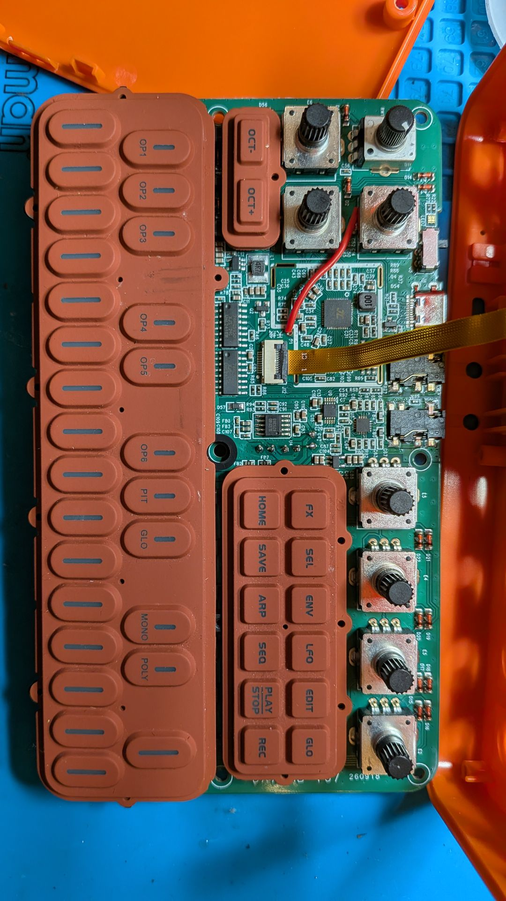 | 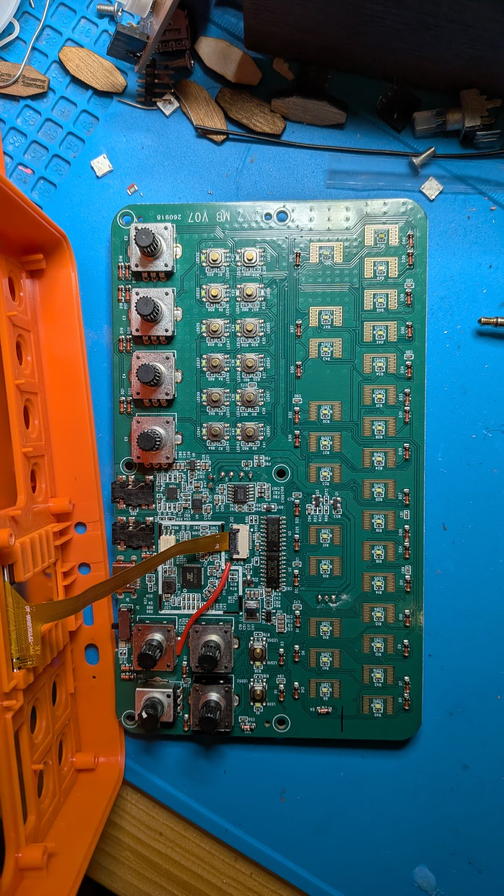 |

| PCB Underside (`DTP704060` LiPo & Mid-Mount Jacks) | Stock Plastic Top & Bottom Shells |
| :---: | :---: |
| 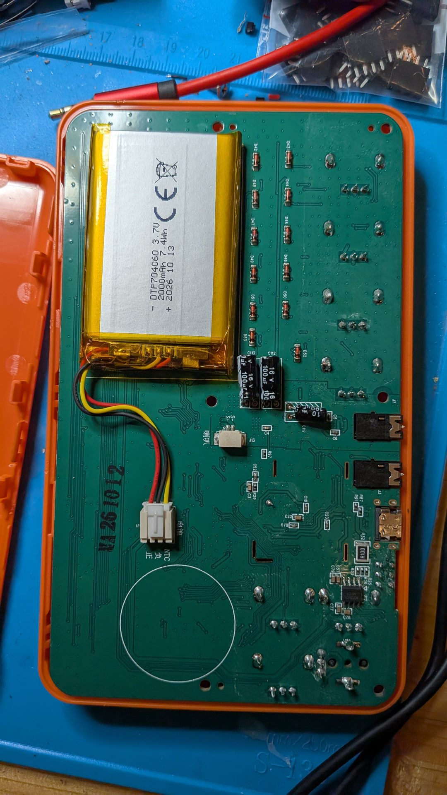 | 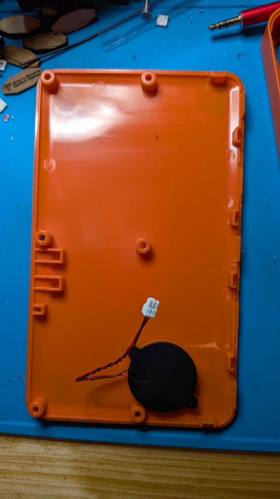 |

---

### 3. Rear Edge Ports & ON/OFF Switch Calibration

Inspecting the rear edge of the PCB and the stock orange switch cap revealed how the rear ports and power switch are arranged:
* **Mid-Mount Jacks & USB-C:** The two 3.5mm jacks (`Audio Out` and `MIDI In`) and the `USB-C` receptacle sit inside notched cutouts in the `1.6 mm` PCB so their centerlines lie directly on the **middle axis of the PCB (`Z = -0.8 mm`)**, flush with the rear PCB edge (`Y = 94.6 mm`).
* **Top-Mounted SMD Power Switch & Offset Cap:** The right-angle SMD slide switch (`J5`) sits **on top of the PCB** (`~2 mm` higher than the PCB middle axis). In the stock plastic enclosure, a tiny molded orange plastic cap ([`photos/original_switch_cap.jpg`](photos/original_switch_cap.jpg)) slips over the SMD switch pin via an upper slot while its round `Ø3.5 mm` button peg steps **down** to exit the case at the lower jack centerline level.
* **Laser-Cut Case Calibration:**
  1. The PCB is anchored directly against the inside of the Back Panel (`rear_pcb_clearance = 0.2 mm`) at any `case_depth` or `panel_tilt`.
  2. The 3.5mm and USB-C cutouts in [`back_panel()`](fm1_lasercut_case.scad) have adjustable **plug barrel clearance** (`jack_barrel_dia = 8.5 mm`, `usbc_barrel_width = 12.8 mm`) so bulky cable overmolds pass into the `3.0 mm` wooden wall and click fully into the jacks.
  3. Without the stock step-down cap, the switch cutout in the back panel is raised `+2.0 mm` in Z to align directly with the SMD switch on top of the PCB.

| Rear Edge View (Mid-Mount Jacks Centered in PCB) | Original Step-Down Switch Cap | Laser-Cut Rear Panel Fit Check |
| :---: | :---: | :---: |
| 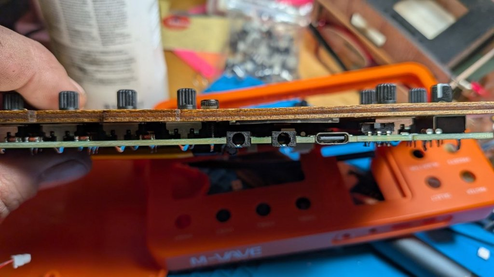 | 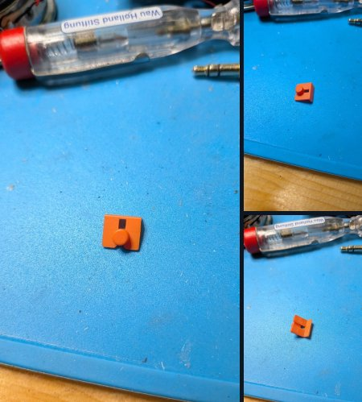 |  |

---

### 4. Final Prototype Build, Screen Integration & Speaker Upgrade

With the screen ribbon cable repaired and the 1.54" display mounted and running, the laser-cut frontplate holds the FM-1 securely. The extra internal vertical depth of the tilted vintage enclosure (`case_internal_height = 25 mm` at the front, rising with the `12°` tilt at the rear) acts as a resonant acoustic enclosure and provides enough room underneath the PCB to upgrade the tiny `Ø26.5 × 4.2 mm` stock capsule to a **much larger full-range speaker**.

| Final Prototype — Screen Running | Final Prototype — Side Cheek Profile | Internal Volume & Bigger Speaker Upgrade |
| :---: | :---: | :---: |
|  |  | 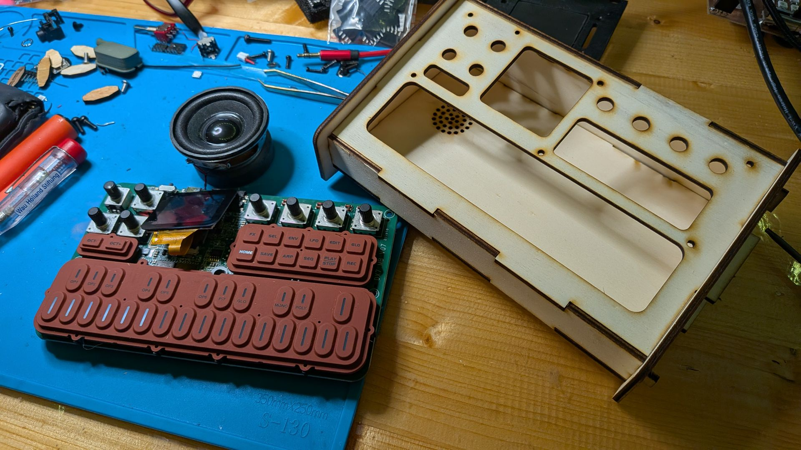 |

---

## OpenSCAD Files & Customizer Parameters

* **[`fm1_lasercut_case.scad`](fm1_lasercut_case.scad)** — Main parametric laser-cut enclosure generator (3D assembly, exploded view, and 2D laser-cutting layout).
* **[`fm1_pcb_and_silicone.scad`](fm1_pcb_and_silicone.scad)** — Complete 3D hardware model of the FM-1 internals (can be viewed standalone or inside the case).
* **[`fm1_lasercut_case.json`](fm1_lasercut_case.json)** — Saved OpenSCAD Customizer presets (`highVintage`, `megaVintage`, `superVintage`).

### Key Customizer Parameters (`highVintage` Default)

| Category | Parameter | Default | Description |
| :--- | :--- | :---: | :--- |
| **Case Dimensions & Tilt** | `case_width` | `170.0 mm` | Internal width between the side cheeks (`162 mm` min tight fit) |
| | `case_depth` | `100.0 mm` | Sloped depth of the top faceplate (`PCB` stays anchored to back wall) |
| | `case_internal_height` | `25.0 mm` | Internal front wall height (`Z`) |
| | `panel_tilt` | `12.0°` | Ergonomic desktop tilt angle towards the player |
| | `pcb_frontplate_distance` | `5.6 mm` | Standoff/spacer distance between PCB top surface and frontplate underside |
| **Rear Ports & Switch** | `jack_barrel_dia` | `8.5 mm` | 3.5mm MIDI & Audio jack hole diameter for plug barrel clearance |
| | `usbc_barrel_width` | `12.8 mm` | USB-C cutout width for cable overmold clearance |
| | `usbc_barrel_height` | `6.8 mm` | USB-C cutout height for cable overmold clearance |
| | `power_switch_mode` | `"laser_slider"` | `"laser_slider"`, `"finger_notch"`, or `"stock_cap"` |
| **Vintage Side Cheeks** | `cheek_extension` | `7.0 mm` | Overhang of the sculpted side panels past the main box |
| | `cheek_radius_top` | `8.0 mm` | Corner radius for the top-front and top-back cheek profile |
| | `cheek_radius_bottom` | `2.0 mm` | Corner radius for the bottom-front and bottom-back cheek feet |
| **Speaker & Acoustics** | `speaker_type` | `"aliexpress_40mm"` | `"aliexpress_40mm"`, `"upgrade_50mm"`, `"stock_26mm"`, `"custom"`, or `"none"` |
| | `resonator_type` | `"helmholtz_laser_duct"` | `"helmholtz_laser_duct"`, `"helmholtz_3d_pod"`, `"stepped_clamp_laser"`, `"spider_clamp_3d"`, `"retainer_ring"`, or `"none"` |
| | `speaker_grille_style` | `"fm1_pinwheel"` | `"fm1_pinwheel"`, `"perforated"`, `"open_hole"`, or `"none"` |
| | `speaker_x` / `speaker_y` | `38.0` / `64.0 mm` | Speaker position in FM-1 coordinates (Rear-Left cavity) |
| **Material & Laser** | `thickness` | `3.0 mm` | Material thickness for Top, Bottom, Front, and Back panels |
| | `thickness_sides` | `6.5 mm` | Independent material thickness for the Left & Right wooden cheeks (`0` = same as `thickness`) |
| | `notch_length` | `30.0 mm` | Target finger-joint tab length |
| | `kerf` | `0.08 mm` | Laser kerf compensation |

### Exporting 2D DXF / SVG for Laser Cutting

1. Open [`fm1_lasercut_case.scad`](fm1_lasercut_case.scad) in [OpenSCAD](https://openscad.org/).
2. Adjust `thickness`, `thickness_sides`, and case dimensions in the **Customizer** pane (or select the `highVintage` preset).
3. Under **Display Mode**, set `part_to_show` to:
   * `"layout"` for the full 2D sheet (or export `"left"` / `"right"` separately when cutting the side cheeks from thicker wood like `6.5 mm`).
4. Press **F6** (Render) and choose **File → Export → Export as SVG / DXF**.

---

## Recent Improvements & Hardware Milestones

* **Functional Captive ON/OFF Slider:**
  * The captive laser-cut slider mechanism ([`power_switch_slider_2d()`](fm1_lasercut_case.scad)) successfully engages and toggles the recessed right-angle SMD power switch from the rear wall. A light sanding/grinding ensures a smooth, low-friction sliding fit.
* **Screen Aperture & Custom Wooden Bezel:**
  * Redesigned the faceplate opening (`screen_mount_style = "bare_screen"`) to precisely frame the bare 1.54" LCD module ($32.0 \times 34.5\,\text{mm}$), eliminating the risk of crushing or stressing the delicate 10-pin ribbon cable.
  * Added a standalone laser-cut thin wooden bezel frame ([`laserfiles/fm1_lasercut_screen_frame.svg`](laserfiles/fm1_lasercut_screen_frame.svg)) with decorative accent scoring and an optional clear acrylic dust shield.
  * Screen ribbon cable repaired and verified running in the physical prototype!
* **Under-PCB Keyboard Anti-Flex Support Rail:**
  * The factory PCB lacks mounting screws below the keyboard row ($Y < 44.5\,\text{mm}$), causing the keys to flex. A laser-cut upright support rail (`pcb_lower_support = "laser_rail"`) with 3 mortise tabs locks into the bottom panel and supports the front margin of the PCB flush at $16.76\,\text{mm}$ height without interfering with internal wiring.
* **Vector Frontplate Engraving Artwork:**
  * Complete SVG engraving artwork ([`laserfiles/fm1_frontplate_engraving.svg`](laserfiles/fm1_frontplate_engraving.svg)) reproducing all 8 encoder function labels (`MASTER`, `SELECT`, `PRESETS`, `ALGORITHM`, `KNOB1`–`KNOB4`), 7 radial dial graduation ticks, `M-VAVE` / `FM-1` branding, and keyboard octave markers (`C2`–`C5`).
* **Upgraded 40mm Speaker & Laser-Cut Helmholtz Resonator Stack:**
  * Upgraded from the tinny 26mm stock capsule to a full-range 40mm driver and a 6-layer laser-cut wood Helmholtz bass-reflex duct stack ([`helmholtz_laser_parts_2d()`](fm1_lasercut_case.scad)), clamped securely with M3 machine screws and vented through the bottom pinwheel grille.
  * Full acoustic analyses and design logs are archived in [`docs/ACOUSTICS_AND_RESONATOR_PLAN.md`](docs/ACOUSTICS_AND_RESONATOR_PLAN.md) and [`docs/ACOUSTICS_DEEP_ENGINEERING_ANALYSIS.md`](docs/ACOUSTICS_DEEP_ENGINEERING_ANALYSIS.md).
* **Streamlined OpenSCAD View Selector:**
  * Reorganized `part_to_show` right at the top of [`fm1_lasercut_case.scad`](fm1_lasercut_case.scad) into a single, clean dropdown categorized into `3D Views`, `2D Laser Sheet`, `2D Case Panels`, `2D Small Parts`, and `3D Print (STL)` models.

---

## Known Issues & Future To-Do

* [ ] **Acoustic Benchmarking & Real-World Sound Comparisons:**
  * While the initial laser-cut Helmholtz duct has been assembled and tested in the prototype, it was glued under preliminary workbench conditions (imperfect layer-to-layer acoustic seal).
  * Systematically measure and compare sound pressure level (SPL) and bass extension across different real-world acoustic configurations:
    1. Stock `Ø26.5 mm` capsule in the original plastic shell.
    2. Upgraded 40mm driver unbaffled inside the open wooden cabinet.
    3. Fully sealed & M3-clamped 6-layer laser Helmholtz duct.
    4. 3D-printed curved Helmholtz tub pod ([`helmholtz_3d_pod_model()`](fm1_lasercut_case.scad)).
* [ ] **Improved Teardown Guide & Screen Extraction Method:**
  * In the stock Cuvave enclosure, the 1.54" display is heavily glued into the orange front shell while tethered by a short, fragile ribbon cable to connector `J12`.
  * Develop and document a reliable, repeatable release technique (e.g. gentle localized heat, isopropanol adhesive softening, or a 3D-printed extraction jig) so makers can extract the screen without risking snapping the black FPC latch or tearing the flat flex cable.
* [ ] **Fully 3D-Printable Enclosure Fork:**
  * Create a dedicated fork / variant of the vintage desktop case optimized specifically for FDM 3D printing (monolithic chassis with threaded inserts/screw bosses, print-in-place tolerances, integrated acoustic cavity, and curved vintage surfaces rather than 2D laser finger joints).

---

## License

This project is licensed under the **[Creative Commons Attribution-ShareAlike 4.0 International License (CC BY-SA 4.0)](LICENSE)**.

---

*Bruce Lee rules · Open source — hack, remix, share.*

