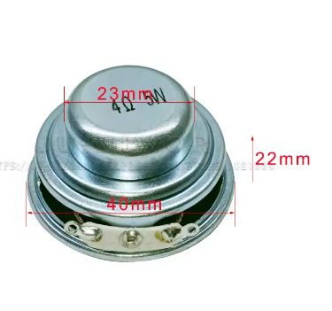
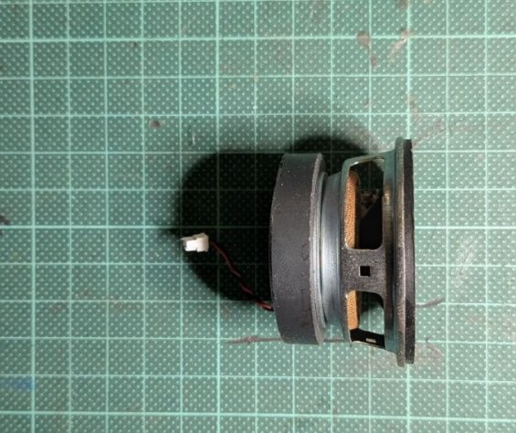
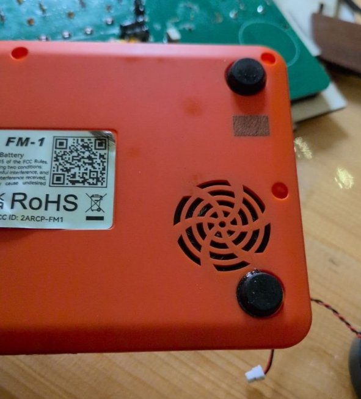
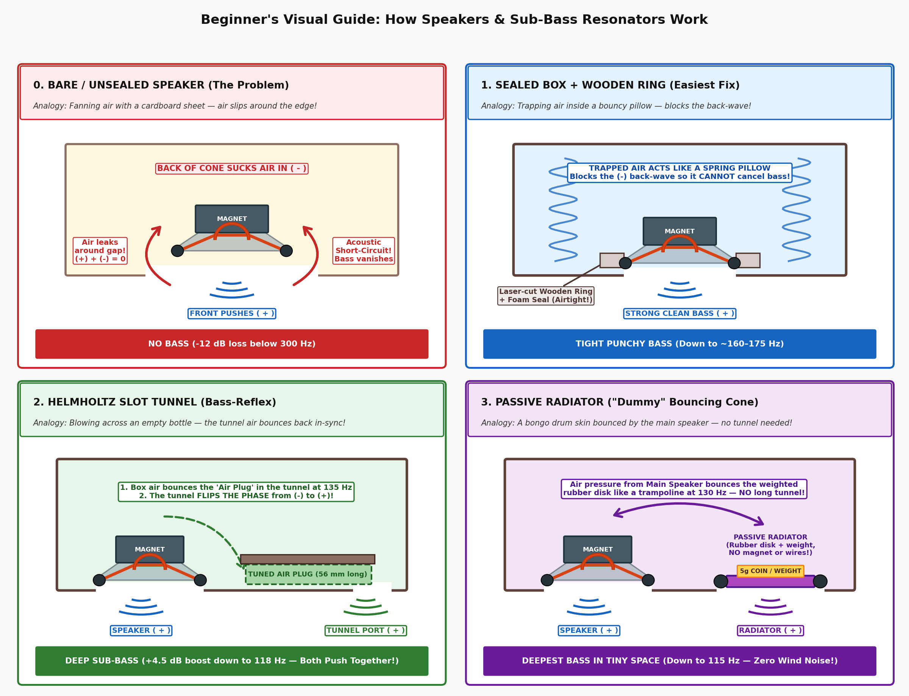
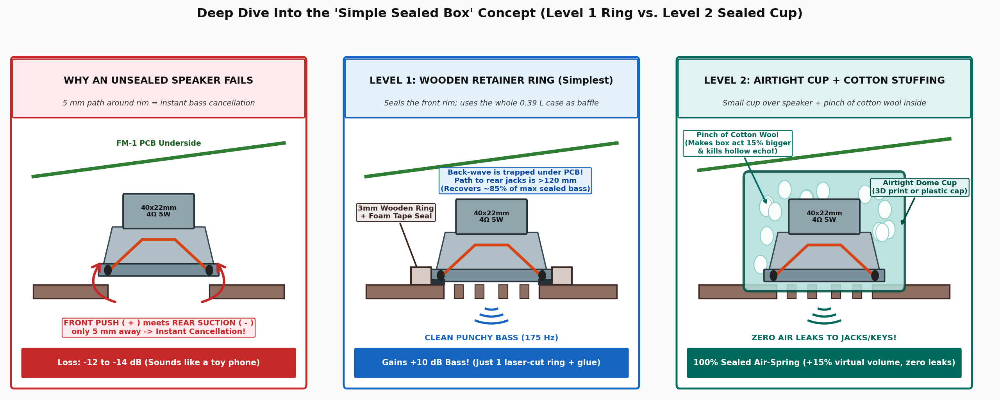
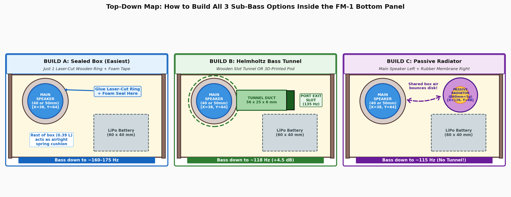
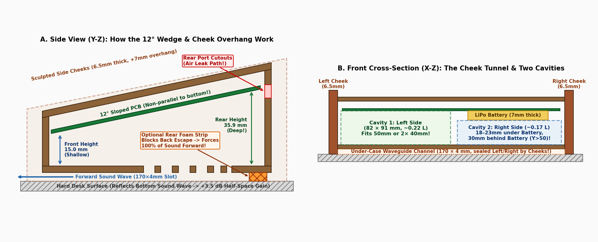

# Acoustic & Sub-Bass Resonator Guide — M-VAVE FM-1 Vintage Case

> **How this guide is organized:**
> * **This document (`ACOUSTICS_AND_RESONATOR_PLAN.md`)** is a **clear, beginner-friendly visual guide** explaining how the speakers and resonators work, why we chose the **`40 × 22 mm` speaker + `135 Hz` Helmholtz Resonator**, and how to export/build it in OpenSCAD ([`fm1_lasercut_case.scad`](../fm1_lasercut_case.scad)).
> * **Want the full math, Thiele-Small tables, differential equations, and engineering nomographs?**
>   👉 Jump to [**`ACOUSTICS_DEEP_ENGINEERING_ANALYSIS.md`**](ACOUSTICS_DEEP_ENGINEERING_ANALYSIS.md).

| Chosen Speaker: AliExpress `40 × 22 mm` (`4Ω 5W`) | Alternative Big Speaker: `50 × 31 mm` (`Ø45 mm` Magnet) | Stock FM-1 Curved Pinwheel Grille |
| :---: | :---: | :---: |
|  |  |  |

---

## 1. Our Chosen Setup: `40 × 22 mm` Speaker + `135 Hz` Helmholtz Resonator

After comparing all drivers and resonator types, our default design (`highVintage` preset in [`fm1_lasercut_case.scad`](../fm1_lasercut_case.scad)) uses:
* **Speaker:** **AliExpress `40 × 22 mm` (`4Ω 5W`, `Ø23 mm` shielded steel cup)** mounted face-down on the Bottom Panel at **`[X = 38 mm, Y = 64 mm]`** (Rear-Left cavity).
  * **Why it wins:** At only `22 mm` tall, it fits inside the slim `25 mm` wooden case with **`+7.1 mm` of vertical clearance** under the tilted PCB (no need to make the case taller!), moves **`2.1×` more air** than the tiny stock capsule, and pairs smoothly with our internal volume. *(See [Deep Analysis §2 — Driver Specs](ACOUSTICS_DEEP_ENGINEERING_ANALYSIS.md#2-driver-specifications-measured-vs-estimated-thiele-small-parameters)).*
* **Resonator:** **`135 Hz` Helmholtz Bass-Reflex Slot Tunnel (`56 mm` long × `25 mm` wide × `6 mm` high)** extending from the speaker at `[X=38, Y=64]` into the empty Rear-Right cavity behind the LiPo battery (`[X=118, Y=64]`), where it fires downward through a dual-slot exit vent in the Bottom Panel.
  * **What it does:** Instead of trapping and wasting the sound wave from the back of the speaker cone, the `56 mm` air tunnel acts like blowing across a bottle at `135 Hz` — **flipping the rear wave in-sync (`+` + `+`)** with the front cone to boost sub-bass by **`+4.5 dB`** down to **`118 Hz`**. *(See [Deep Analysis §4 — Helmholtz Port Math & Nomograph](ACOUSTICS_DEEP_ENGINEERING_ANALYSIS.md#4-helmholtz-bass-reflex-port-derivations--tuning-nomograph)).*

### Two Ways to Build It in OpenSCAD (`resonator_type` Dropdown)
Both versions are built right into [`fm1_lasercut_case.scad`](../fm1_lasercut_case.scad) under `/* [Speaker & Acoustic Grille] */`:

| Build Method | `resonator_type` Setting | How to Export & Assemble |
| :--- | :--- | :--- |
| **Option 1 (Recommended): 3D-Printed Airtight Pod + Laser-Cut Bottom Exit Slot** | `"helmholtz_3d_pod"` *(Default)* | 1. Set `part_to_show = "helmholtz_pod"` → **Export as STL** and 3D-print on any FDM printer (`26 mm` tall, clears PCB by `+3.1 mm`). 2. Set `part_to_show = "layout"` → **Export as DXF/SVG** and laser-cut the wooden panels. 3. Drop the `40 mm` speaker onto the pinwheel grille and glue/screw the 3D pod right over it! |
| **Option 2 (No 3D Printer Needed): 100% Laser-Cut Stacked Wood Tunnel** | `"helmholtz_laser_duct"` | 1. Set `resonator_type = "helmholtz_laser_duct"` and `part_to_show = "layout"`. 2. Laser-cut the 3 extra wooden resonator pieces included in the layout (**2× Tunnel Wall Layers** + **1× Tunnel Roof Plate**). 3. Glue the 2 wall layers (`6 mm` tall) + roof plate (`3 mm` tall) onto the inside of the Bottom Panel and press the `40 mm` speaker into the ring! |

---

## 2. Beginner's Visual Guide: How Speakers & Sub-Bass Resonators Work

Why do we need a sealed ring, a Helmholtz tunnel, or a passive radiator in the first place? Look at the 4 panels below:

### Panel 0: Bare / Unsealed Speaker ("Acoustic Short-Circuit" — Why Bass Vanishes)
* **Analogy:** Fanning yourself with a piece of cardboard that has a hole in the middle — air just slips around the edge instead of blowing forward.
* **What happens:** When the speaker cone pushes down (`+`), the back of the cone sucks air in (`-`). If the speaker rim isn't sealed to the bottom panel, that `-` suction wave loops around the rim and cancels the `+` wave (`+` meets `-` = **zero bass below `300 Hz`**).
* *(Formula & graph: [Deep Analysis §3.1 — Acoustic Dipole Short-Circuit](ACOUSTICS_DEEP_ENGINEERING_ANALYSIS.md#31-acoustic-dipole-short-circuit-unbaffled-driver)).*

### Panel 1: Sealed Box + Wooden Ring ("The Bouncy Air Pillow" — Easiest Fix)
* **Analogy:** Putting your thumb over the nozzle of a bicycle pump — the trapped air acts like a springy cushion.
* **What happens:** Gluing the laser-cut wooden ring (`resonator_type = "retainer_ring"`) + thin foam tape around the speaker rim traps the `-` back-wave inside the box so it **cannot** leak out and cancel your bass.
* **Result:** Tight, punchy synth bass down to **`~160–175 Hz`**, boosting bass by **`+10 to +14 dB`** over an unsealed speaker.
* **Two Levels of "Simple Sealed Box" Inside Our FM-1 Case:**

  1. **Level 1 — Just the Laser-Cut Wooden Ring (`resonator_type = "retainer_ring"`):**
     * Seals the **front rim** of the speaker to the Bottom Panel, while using the **entire `0.39 L` wooden case** under the PCB as the rear chamber.
     * Even though the outer wooden case isn't 100% airtight (air can slowly breathe out through the rear USB-C/Audio jack cutouts or silicone button gaps `120 mm` away), sealing the front rim stretches the cancellation path from `5 mm` to `>120 mm` — recovering **`~85%` of the bass (`+10 dB`)** with just 1 laser-cut ring!
     * **Bonus with the AliExpress `40 × 22 mm` speaker:** Its galvanized steel basket is shaped like a semi-enclosed dish shroud with only a narrow felt-damped ring vent, so it already acts like a partially self-enclosed driver!
  2. **Level 2 — True 100% Airtight Cup + Cotton Stuffing:**
     * Instead of trying to caulk every wooden finger-joint and jack hole of the whole synth case, you glue a small **`Ø48 × 25 mm` airtight cup** (3D-printed dome, or even a plastic pill bottle cap / PVC end-cap) right over the back of the speaker on the Bottom Panel.
     * **The Cotton Wool Trick:** Loosely placing a **fluffy pinch of cotton wool or pillow stuffing (`~1 gram`)** inside that cup slows down the air molecules and absorbs heat as the air compresses, making the speaker think the cup is **`15–20%` larger** than it physically is while killing hollow plastic midrange echoes!
* *(Formula & graph: [Deep Analysis §3.2 — Closed-Box Transfer Function](ACOUSTICS_DEEP_ENGINEERING_ANALYSIS.md#32-closed-box-sealed-air-suspension-transfer-function)).*

### Panel 2: Helmholtz Slot Tunnel ("Blowing Across a Bottle" — Our Chosen Build!)
* **Analogy:** Blowing across the top of an empty glass bottle to make a loud, deep `"WHOOOO"` bass note.
* **What happens:** The air inside the speaker chamber acts like a **spring**, and the `56 mm` plug of air sitting inside the narrow `25 × 6 mm` tunnel acts like a **weight**. When the speaker plays bass notes around **`135 Hz`**, the plug of air in the tunnel bounces wildly and **flips the phase of the rear wave from `(-)` to `(+)`**!
* **Result:** Both the speaker cone AND the tunnel exit port push `+` air out of the bottom panel at the same time — adding **`+4.5 dB` of sub-bass** and extending low notes down to **`118 Hz`**.
* *(Formula & nomograph: [Deep Analysis §4 — Helmholtz Port Derivations](ACOUSTICS_DEEP_ENGINEERING_ANALYSIS.md#4-helmholtz-bass-reflex-port-derivations--tuning-nomograph)).*

### Panel 3: Passive Radiator ("The Sympathetic Bongo Drum" — No Tunnel Needed)
* **Analogy:** A sealed drum with two skins — hitting Skin #1 uses internal air pressure to bounce Skin #2 automatically.
* **What happens:** Instead of a `56 mm` air tunnel, you mount a **flat weighted rubber membrane** (a `Ø40 mm` speaker cone with a `5g` coin/washer weight and **no magnet or wires**) in the empty **Rear-Right spot (`[X=126, Y=68]`)** behind the battery. The main speaker's air pressure bounces that rubber disk at `130 Hz` in-sync (`+` + `+`).
* **Result:** Reaches **`115 Hz`** with **zero tunnel space** and **zero wind noise**.
* *(Formula & schematic: [Deep Analysis §7.2 — Hybrid Concept 3](ACOUSTICS_DEEP_ENGINEERING_ANALYSIS.md#72-hybrid-3d-printed--laser-cut-concepts)).*

### Where Each Option Fits on the FM-1 Bottom Panel

---

## 3. How the Wooden Case Shape & "Cheek Tunnel" Boost the Sound

Our case (`170 × 98.4 mm`, tilted at **`12°`**) has two built-in acoustic advantages:

1. **The `12°` Tilted Wedge Stops "Boxy" Echoes:**
   * Inside the case, the space under the PCB grows from `15 mm` at the front keys to `35.9 mm` at the back knobs. Because the PCB and Bottom Panel are **not parallel**, midrange sound waves bounce diagonally instead of slapping straight up and down.
2. **Two Empty Rear Pockets (`[38, 64]` & `[126, 68]`):**
   * The `60 × 40 mm` LiPo battery sits on the front-right, leaving **two `30 mm` deep pockets at the back**: **Rear-Left (`[38, 64]`)** for our main speaker, and **Rear-Right (`[126, 68]`, behind the battery)** for our Helmholtz tunnel exit (or a second speaker / passive radiator).
3. **The 10-Second "Cheek Tunnel" Megaphone Trick:**
   * The left and right wooden side cheeks lift the Bottom Panel **`4.0 mm` off the table**, forming a `170 × 4 mm` tunnel under the synth.
   * **Do this on every build:** Stick a **`170 × 8 × 4 mm` strip of foam or wood** along the **rear bottom edge** between the two cheeks (orange block in Figure A above). That blocks sound from escaping out the back and bounces **100% of the speaker + Helmholtz port sound forward toward your ears**!
   * *(Full geometry math: [Deep Analysis §1 — Enclosure Geometry & Boundary-Waveguide Physics](ACOUSTICS_DEEP_ENGINEERING_ANALYSIS.md#1-enclosure-geometry--boundary-waveguide-physics-12-wedge--cheek-tunnel)).*

---

## 4. Other Ideas Worth Knowing (50mm Speaker, Dual Speakers & 2-Way Tweeter)

If you ever want to experiment beyond the single `40 × 22 mm` + Helmholtz setup, here are the key findings from our engineering analysis:

| Idea | How It Works | What You Need to Know | Deep Analysis Link |
| :--- | :--- | :--- | :---: |
| **1. Using Your Bigger `50 × 31 mm` Speaker** | Moves `3.3×` more air than stock (`12.6 cm²` cone), deepest natural bass ($f_s \approx 145\,\text{Hz}$). | At `31 mm` tall, it is `2 mm` too tall for the `25 mm` case at `[38, 64]`. Either set `case_internal_height = 29` in OpenSCAD, **OR** set `speaker_z_offset = -3` with `speaker_grille_style = "open_hole"` so it drops `3 mm` into the bottom panel. | [Deep Analysis §2](ACOUSTICS_DEEP_ENGINEERING_ANALYSIS.md#2-driver-specifications-measured-vs-estimated-thiele-small-parameters) & [§6](ACOUSTICS_DEEP_ENGINEERING_ANALYSIS.md#6-sub-pcb-3d-obstacle-clearance-map--case-height-scaling) |
| **2. Dual `2× 40 × 22 mm` Speakers (Left + Right)** | Mounts Speaker #1 at Rear-Left `[38, 65]` and Speaker #2 at Rear-Right `[126, 68]` (behind the battery). | Two `40 mm` speakers have **$28\%$ MORE cone area (`16.1 cm²`) than a single `50 mm` speaker**, and both fit inside the slim `25 mm` case! Wire two **`8 Ω`** drivers in **parallel** (`= 4 Ω`) or two **`4 Ω`** drivers in **series** (`= 8 Ω`). | [Deep Analysis §5.1](ACOUSTICS_DEEP_ENGINEERING_ANALYSIS.md#51-mutual-acoustic-coupling-of-two-40--22-mm-drivers) |
| **3. Zero-Cost "Woofer + Tweeter" (2-Way)** | Reuses the tiny **`26.5 mm` stock FM-1 speaker** you removed! Mount it at Front-Left `[25, 21]` wired in parallel through a **`6.8 µF` capacitor**. | Bottom-firing speakers muffle high notes (`>4 kHz`) against the desk. The `6.8 µF` capacitor blocks bass from the tiny stock speaker so it acts as a dedicated **tweeter** for sparkling FM bells while your `40 mm` speaker plays the bass! | [Deep Analysis §5.2](ACOUSTICS_DEEP_ENGINEERING_ANALYSIS.md#52-first-order-capacitive-high-pass-crossover-for-stock-265-mm-tweeter) |
| **4. Four 3D-Printed Hybrid Upgrades** | 1. Airtight Pod + Flared Port (`helmholtz_3d_pod`) 2. `12°` Wedge Baffle Cradle for `50 mm` speaker 3. TPU Passive Radiator Membrane 4. Under-Slung Exponential Horn Plinth | All 4 cross-sections and equations are detailed in the engineering reference. | [Deep Analysis §7.2](ACOUSTICS_DEEP_ENGINEERING_ANALYSIS.md#72-hybrid-3d-printed--laser-cut-concepts) |

---

## 5. Complete Index of Engineering Diagrams & Reference Docs

* **Full Engineering Reference Document:** [**`docs/ACOUSTICS_DEEP_ENGINEERING_ANALYSIS.md`**](ACOUSTICS_DEEP_ENGINEERING_ANALYSIS.md)
* **Visual Diagrams in `docs/acoustics/`:**
  1. [`beginner_resonators_explained.png`](acoustics/beginner_resonators_explained.png) — 4-panel beginner cartoon explaining Unsealed vs. Sealed vs. Helmholtz Tunnel vs. Passive Radiator.
  2. [`beginner_3_builds_inside_fm1.png`](acoustics/beginner_3_builds_inside_fm1.png) — Top-down map of the 3 sub-bass builds inside the FM-1 bottom plate.
  3. [`current_case_wedge_acoustics.png`](acoustics/current_case_wedge_acoustics.png) — Cross-sections of the `12°` wedge enclosure, internal cavities, and under-case "cheek tunnel" + rear foam dam.
  4. [`spl_frequency_response.png`](acoustics/spl_frequency_response.png) — Calculated SPL frequency response (dB) and cone excursion $|X(f)|$ curves.
  5. [`helmholtz_port_tuning_nomograph.png`](acoustics/helmholtz_port_tuning_nomograph.png) — Helmholtz slot port physical length $L_p$ vs. tuning frequency $f_B$ nomograph.
  6. [`pcb_underside_clearance_map.png`](acoustics/pcb_underside_clearance_map.png) — Scale 2D + Z-clearance map of PCB underside obstacles (`J1`, `J13`, LiPo battery, encoder pins).
  7. [`multi_speaker_layouts_and_spl.png`](acoustics/multi_speaker_layouts_and_spl.png) — Multi-speaker placement zones (`[38, 65]`, `[126, 68]`, `[25, 21]`) and `2× 40mm` / 2-Way SPL curves.
  8. [`resonator_cross_sections.png`](acoustics/resonator_cross_sections.png) — 3 pure laser-cut plywood architectures.
  9. [`3d_printed_hybrid_concepts.png`](acoustics/3d_printed_hybrid_concepts.png) — 4 hybrid 3D-printed sub-enclosure, wedge cradle, passive radiator, and horn plinth concepts.
