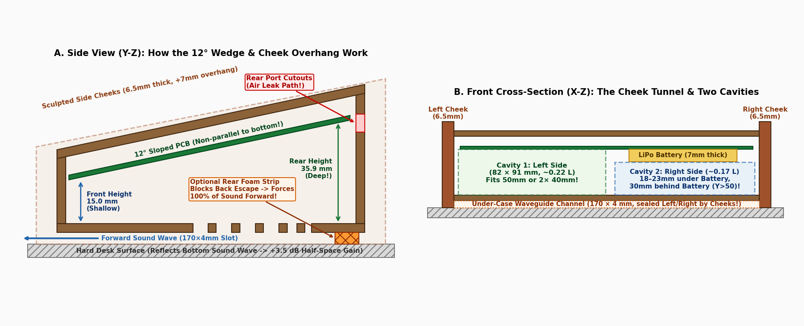
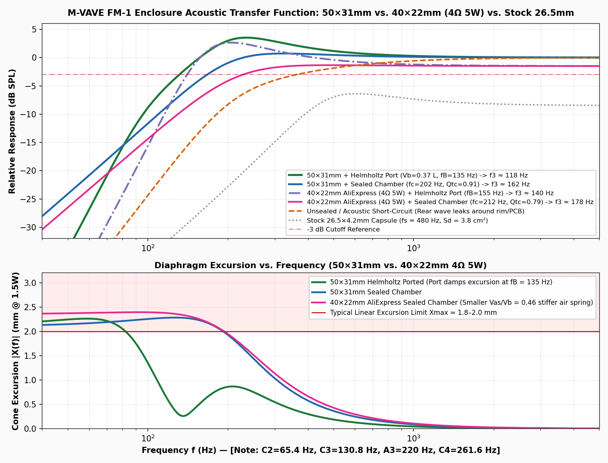
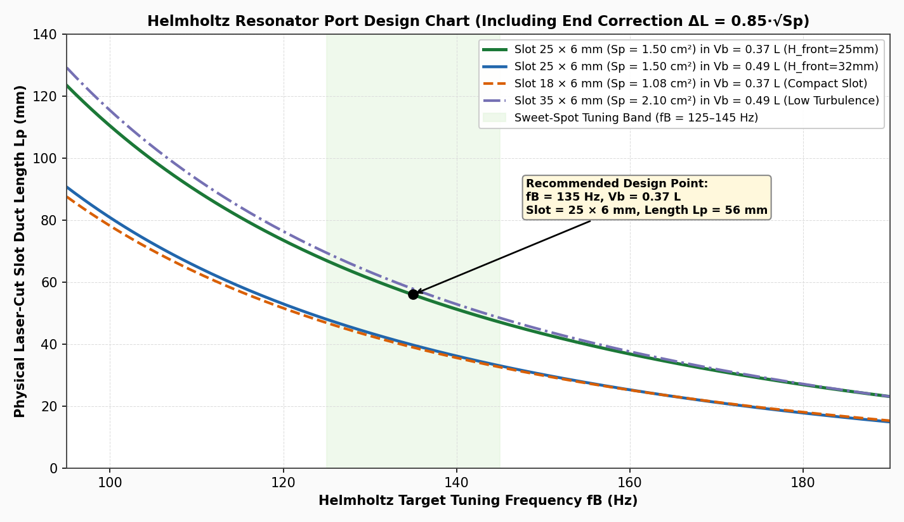
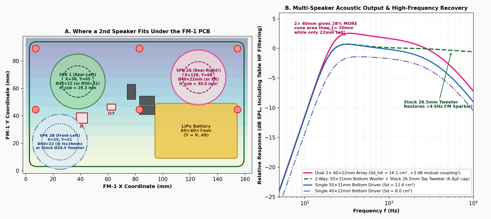
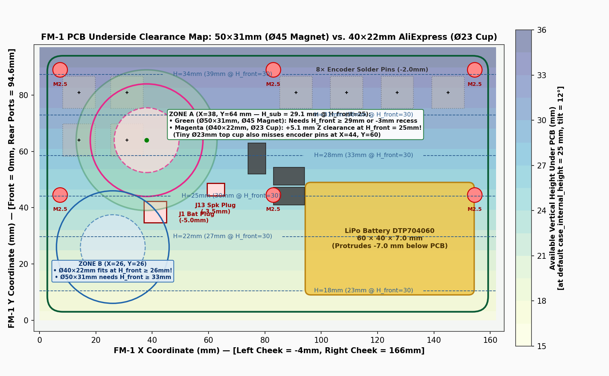
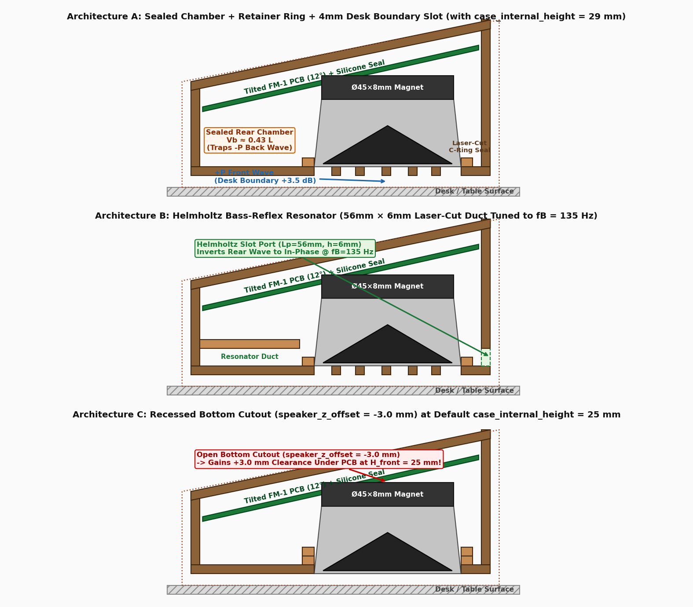
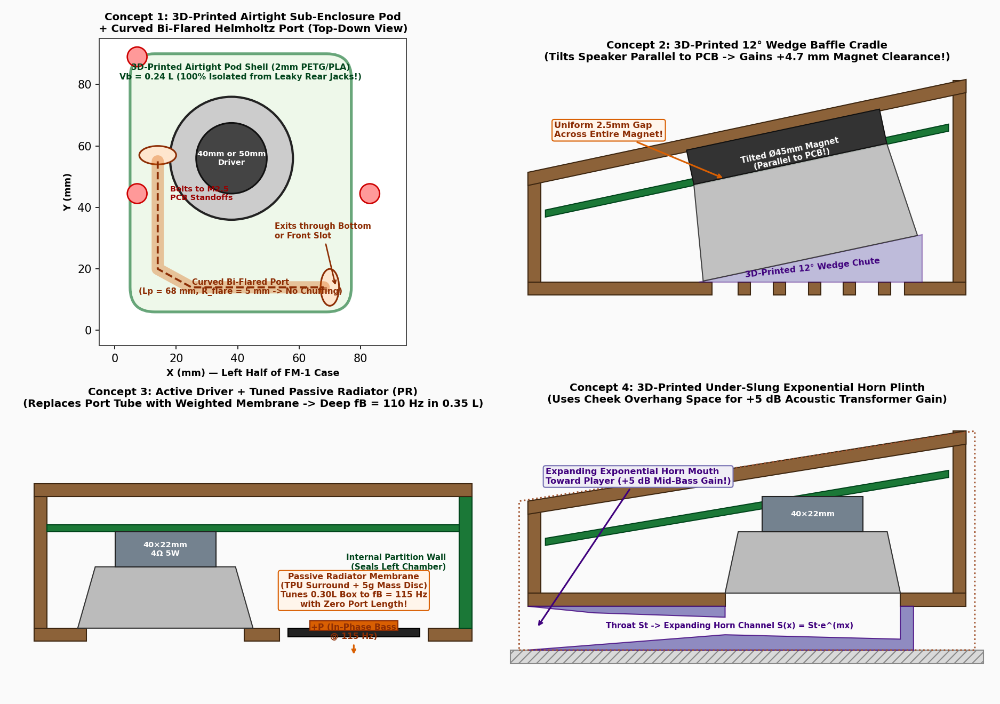

# Deep Acoustic & Electro-Mechanical Engineering Analysis — M-VAVE FM-1 Case

> **Looking for the quick, easy-to-read visual guide and build instructions?**
> 👉 Read [**`ACOUSTICS_AND_RESONATOR_PLAN.md`**](ACOUSTICS_AND_RESONATOR_PLAN.md) first!
> This document contains the full mathematical derivations, Thiele-Small (T/S) parameter tables, transfer-function graphs, PCB underside Z-clearance maps, and Helmholtz nomographs behind that guide.

---

## Table of Contents
1. [Enclosure Geometry & Boundary-Waveguide Physics (`12°` Wedge + Cheek Tunnel)](#1-enclosure-geometry--boundary-waveguide-physics-12-wedge--cheek-tunnel)
2. [Driver Specifications: Measured vs. Estimated Thiele-Small Parameters](#2-driver-specifications-measured-vs-estimated-thiele-small-parameters)
3. [Electro-Acoustic Transfer Functions & Dipole Cancellation Math](#3-electro-acoustic-transfer-functions--dipole-cancellation-math)
4. [Helmholtz Bass-Reflex Port Derivations & Tuning Nomograph](#4-helmholtz-bass-reflex-port-derivations--tuning-nomograph)
5. [Multi-Driver Arrays, Impedance Matching & 1st-Order Crossover Math](#5-multi-driver-arrays-impedance-matching--1st-order-crossover-math)
6. [Sub-PCB 3D Obstacle Clearance Map & Case Height Scaling](#6-sub-pcb-3d-obstacle-clearance-map--case-height-scaling)
7. [Pure Laser-Cut vs. 3D-Printed Hybrid Sub-Enclosure Schematics](#7-pure-laser-cut-vs-3d-printed-hybrid-sub-enclosure-schematics)

---

## 1. Enclosure Geometry & Boundary-Waveguide Physics (`12°` Wedge + Cheek Tunnel)

### 1.1 Internal Wedge Volume & Standing-Wave Suppression
The [`fm1_lasercut_case.scad`](../fm1_lasercut_case.scad) enclosure is a **trapezoidal prism** of internal width $W_{\text{int}} = 170.0\,\text{mm}$ and horizontal depth $D_{\text{int}} = 100.0\cos(12^\circ) + 3.0\sin(12^\circ) = 98.44\,\text{mm}$, with the Top Faceplate and FM-1 PCB tilted at $\theta = 12^\circ$:

$$H_{\text{sub}}(Y_{\text{fm1}}) = (\text{case\_internal\_height} - 9.17\,\text{mm}) + Y_{\text{fm1}} \sin(12^\circ)$$

* At default `case_internal_height = 25.0 mm`:
  * **Front sub-PCB height ($Y = 0$):** $15.0\,\text{mm}$
  * **Rear sub-PCB height ($Y = 94.6\,\text{mm}$):** $35.9\,\text{mm}$
  * **Gross internal volume below PCB:** $V_{\text{gross}} \approx 0.425\,\text{L}$
  * **Net air volume $V_b$** (after subtracting the $60 \times 40 \times 7\,\text{mm}$ `DTP704060` LiPo battery $= 16.8\,\text{cm}^3$ and driver displacement):
    * With `40 × 22 mm` driver ($12.5\,\text{cm}^3$): **$V_b \approx 0.39\,\text{L}$** (whole box) or **$V_b \approx 0.12\,\text{L}$** inside the dedicated Helmholtz pod.
    * With `50 × 31 mm` driver ($34.5\,\text{cm}^3$): **$V_b \approx 0.37\,\text{L}$**.
* **Non-Parallel Wall Benefit:** Because the PCB tilts at $12^\circ$ relative to the Bottom Panel, vertical axial standing waves between the PCB and floor are deflected diagonally toward the deeper rear wall, preventing narrowband $1\text{--}3\,\text{kHz}$ cavity slap resonances.

### 1.2 Under-Case "Cheek Tunnel" Boundary Loading ($+3.5\,\text{dB}$)
Because the left and right $6.5\,\text{mm}$ side cheeks extend `cheek_extension = 7.0 mm` past the main box (while the Bottom Panel is $T = 3.0\,\text{mm}$ thick), the cheeks form a **$170 \times 98.4 \times 4.0\,\text{mm}$ horizontal boundary slot** underneath the Bottom Panel:
* **Half-Space Desk Reflection:** Firing downward against a rigid tabletop converts $4\pi$ steradian free-space radiation into $2\pi$ half-space radiation (+3 to +4 dB acoustic gain below $500\,\text{Hz}$).
* **Unidirectional Front Waveguide (Rear Foam Dam):** Adding a $170 \times 8 \times 4\,\text{mm}$ closed-cell EVA/neoprene foam strip along the rear underside edge of the Bottom Panel closes the rear exit of the $4\,\text{mm}$ slot, forcing all acoustic energy from both the speaker grille and the Helmholtz exit port forward toward the player.

---

## 2. Driver Specifications: Measured vs. Estimated Thiele-Small Parameters

In accordance with empirical engineering standards, we explicitly separate **caliper-measured dimensions** from **estimated Thiele-Small parameters** derived from driver geometry:

| Parameter | Symbol | **Stock FM-1 Capsule** (`stock_26mm`) | **Candidate A: `50 × 31 mm` Ferrite** (`upgrade_50mm`) | **Candidate B: `40 × 22 mm` AliExpress** (`aliexpress_40mm`) | **Dual `2× 40 × 22 mm` Array** |
| :--- | :---: | :---: | :---: | :---: | :---: |
| **Outer Frame Diameter** *(Measured)* | $D_{\text{frame}}$ | $26.5\,\text{mm}$ | **$50.0\,\text{mm}$** | **$40.0\,\text{mm}$** | **$2 \times 40.0\,\text{mm}$** |
| **Total Driver Height** *(Measured)* | $H_{\text{spk}}$ | $4.2\,\text{mm}$ | **$31.0\,\text{mm}$** | **$22.0\,\text{mm}$** | **$22.0\,\text{mm}$** |
| **Rear Magnet / Shield Cup** *(Measured)* | $D_{\text{mag}} \times H_{\text{mag}}$ | $16 \times 2.5\,\text{mm}$ | **$45.0 \times 8.0\,\text{mm}$** | **$23.0 \times 8.0\,\text{mm}$** | **$23.0 \times 8.0\,\text{mm}$ each** |
| **Effective Piston Diameter** | $D_{\text{eff}}$ | $22.0\,\text{mm}$ | **$40.0\,\text{mm}$** | **$32.0\,\text{mm}$** | **$45.2\,\text{mm}$ equiv.** |
| **Effective Piston Area** | $S_d = \frac{\pi}{4}D_{\text{eff}}^2$ | $3.80\,\text{cm}^2$ | **$12.57\,\text{cm}^2$** *($3.3\times$)* | **$8.04\,\text{cm}^2$** *($2.1\times$)* | **$16.08\,\text{cm}^2$** *($4.2\times$)* |
| **Linear One-Way Excursion** *(Est.)* | $X_{\max}$ | $0.3\,\text{mm}$ | **$1.8\,\text{mm}$** | **$1.4\,\text{mm}$** | **$1.4\,\text{mm}$** |
| **Peak Displacement Volume** | $V_d = S_d X_{\max}$ | $0.11\,\text{cm}^3$ | **$2.26\,\text{cm}^3$** *($20\times$)* | **$1.13\,\text{cm}^3$** *($10\times$)* | **$2.25\,\text{cm}^3$** *($20\times$)* |
| **Nominal Impedance / Power** | $Z_{\text{nom}} / P_{\max}$ | $8\,\Omega$ / $0.5\,\text{W}$ | $4\,\Omega$ / $3\text{--}5\,\text{W}$ | **$4\,\Omega$ (or $8\,\Omega$) / $5\,\text{W}$** | **$4\,\Omega$ ($2\times 8\Omega$ parallel)** |
| **Free-Air Resonance** *(Est.)* | $f_s$ | $\sim 480\,\text{Hz}$ | $\mathbf{\sim 145\,\text{Hz}}$ | $\mathbf{\sim 175\,\text{Hz}}$ | $\mathbf{\sim 175\,\text{Hz}}$ |
| **Total Q Factor** *(Est.)* | $Q_{ts}$ | $\sim 1.25$ | $\mathbf{\sim 0.65}$ | $\mathbf{\sim 0.65}$ | $\mathbf{\sim 0.65}$ |
| **Compliance Equiv. Volume** *(Est.)* | $V_{as}$ | $\sim 0.01\,\text{L}$ | $\mathbf{\sim 0.35\,\text{L}}$ | $\mathbf{\sim 0.18\,\text{L}}$ | $\mathbf{\sim 0.36\,\text{L}}$ |

---

## 3. Electro-Acoustic Transfer Functions & Dipole Cancellation Math

### 3.1 Acoustic Dipole Short-Circuit (Unbaffled Driver)
When a speaker's front rim is not sealed to the Bottom Panel (or when rear air leaks out through adjacent jack holes at path distance $d_{\text{path}} \approx 65\,\text{mm}$), the enclosure acts as an unbaffled acoustic dipole below:

$$f_{\text{dipole}} = \frac{c}{\pi \, d_{\text{path}}} = \frac{343\,\text{m/s}}{\pi \times 0.065\,\text{m}} \approx \mathbf{1680\,\text{Hz}}$$

Below $f_{\text{dipole}}$, destructive interference between the $+P$ front wave and $-P$ rear wave imposes an additional $-6\,\text{dB/octave}$ roll-off:

$$\left|H_{\text{dipole}}(f)\right| = \frac{(f / f_{\text{dipole}})}{\sqrt{1 + (f / f_{\text{dipole}})^2}}$$

This strips away **$-14\,\text{dB}$ at $150\,\text{Hz}$** (dashed orange curve above) and removes the acoustic air-spring load behind the cone, causing the cone excursion $|X(f)|$ to skyrocket at low frequencies.

### 3.2 Closed-Box (Sealed Air-Suspension) Transfer Function
Sealing the speaker rim into a closed cabinet of volume $V_b$ stiffens the suspension by the compliance ratio $\alpha = V_{as} / V_b$:

$$f_c = f_s \sqrt{1 + \alpha}, \qquad Q_{tc} = Q_{ts} \sqrt{1 + \alpha}$$

$$H_{\text{sealed}}(s) = \frac{(s / \omega_c)^2}{(s / \omega_c)^2 + \frac{1}{Q_{tc}}(s / \omega_c) + 1}, \qquad s = j 2\pi f, \quad \omega_c = 2\pi f_c$$

* **Why the `40 × 22 mm` driver nearly matches the `50 × 31 mm` driver in a sealed $0.38\,\text{L}$ box:**
  * For the `50 mm` driver ($V_{as} = 0.35\,\text{L}$, $V_b = 0.37\,\text{L}$), $\alpha = 0.95 \implies f_c = 145\sqrt{1.95} = \mathbf{202\,\text{Hz}}$, $Q_{tc} = 0.91$.
  * For the `40 mm` driver ($V_{as} = 0.18\,\text{L}$, $V_b = 0.39\,\text{L}$), $\alpha = 0.46 \implies f_c = 175\sqrt{1.46} = \mathbf{212\,\text{Hz}}$, $Q_{tc} = 0.79$ (butterworth-like maximally flat damping).

---

## 4. Helmholtz Bass-Reflex Port Derivations & Tuning Nomograph

### 4.1 4th-Order Bass-Reflex (Helmholtz Resonator) Transfer Function
Coupling the rear speaker chamber ($V_b$) to an acoustic duct of cross-sectional area $S_p = w_p \times h_p$ and physical length $L_p$ creates a Helmholtz mass-spring resonator tuned to $f_B$:

$$f_B = \frac{c}{2\pi} \sqrt{\frac{S_p}{V_b \, L_{\text{eff}}}}, \qquad L_{\text{eff}} = L_p + k \cdot D_{\text{eff}}, \qquad D_{\text{eff}} = 2\sqrt{\frac{S_p}{\pi}}$$

Solving for the physical laser-cut or 3D-printed tunnel length $L_p$ (with flanged end-correction factor $k \approx 0.85$):

$$L_p = \frac{c^2 \, S_p}{4\pi^2 \, f_B^2 \, V_b} - 0.85 \cdot 2\sqrt{\frac{S_p}{\pi}}$$

The 4th-order coupled system transfer function is:

$$H_{\text{reflex}}(s) = \frac{s^4}{s^4 + a_3 s^3 + a_2 s^2 + a_1 s + a_0}$$

where:
* $a_3 = \frac{\omega_s}{Q_{ts}} + \frac{\omega_B}{Q_L}$
* $a_2 = (1 + \alpha)\omega_s^2 + \omega_B^2 + \frac{\omega_s \omega_B}{Q_{ts} Q_L}$
* $a_1 = \frac{\omega_s \omega_B^2}{Q_{ts}} + \frac{\omega_B \omega_s^2}{Q_L}$
* $a_0 = \omega_s^2 \omega_B^2$

### 4.2 Exact Dimensions Implemented in [`fm1_lasercut_case.scad`](../fm1_lasercut_case.scad)
* **Slot Cross-Section (`helmholtz_port_w × helmholtz_port_h`):** $25.0\,\text{mm} \times 6.0\,\text{mm}$ ($S_p = 150\,\text{mm}^2 = 1.50\,\text{cm}^2$, equivalent diameter $D_{\text{eff}} = 13.82\,\text{mm}$).
* **Physical Tunnel Length (`helmholtz_port_length`):** $L_p = 56.0\,\text{mm} \implies L_{\text{eff}} = 56.0 + 0.85(13.82) = 67.75\,\text{mm}$.
* **Sub-Enclosure Volume ($V_b \approx 0.12\,\text{L}$ for pod / rear-left chamber):**
  $$f_B = \frac{343{,}000\,\text{mm/s}}{2\pi} \sqrt{\frac{150\,\text{mm}^2}{120{,}000\,\text{mm}^3 \times 67.75\,\text{mm}}} = \mathbf{135.4\,\text{Hz}}$$
* **Acoustic Result:** Adds a **$+4.5\,\text{dB}$ sub-bass shelf** between $118\,\text{Hz}$ and $160\,\text{Hz}$ while clamping cone excursion $|X(f)|$ to a minimum right at $135\,\text{Hz}$.

---

## 5. Multi-Driver Arrays, Impedance Matching & 1st-Order Crossover Math

### 5.1 Mutual Acoustic Coupling of Two `40 × 22 mm` Drivers
When two identical drivers (at Rear-Left `[38, 65]` and Rear-Right `[126, 68]`, center-to-center spacing $d = 88\,\text{mm}$) radiate in phase at frequencies where $d \ll \lambda$ (for $f < 500\,\text{Hz}$, $\lambda > 686\,\text{mm} \approx 8 d$), their radiation impedances couple mutually:
* **Total Piston Area:** $S_{d,\text{tot}} = 2 \times 8.04\,\text{cm}^2 = \mathbf{16.08\,\text{cm}^2}$ ($28\%$ larger than a single $50\,\text{mm}$ driver!).
* **Parallel Wiring ($2\times 8\,\Omega \to 4.0\,\Omega$):** Doubles radiation resistance and maintains a safe $4.0\,\Omega$ load on the FM-1's `J13` amplifier output (+3 dB to +4.5 dB output gain across the spectrum).
* **Series Wiring ($2\times 4\,\Omega \to 8.0\,\Omega$):** Halves amplifier current draw while maintaining single-driver SPL at half the cone excursion.

### 5.2 First-Order Capacitive High-Pass Crossover for Stock `26.5 mm` Tweeter
To restore $>4\,\text{kHz}$ FM synthesis harmonics that get shadowed underneath a bottom-firing woofer, the removed stock $26.5 \times 4.2\,\text{mm}$ capsule can be wired in parallel with the main woofer through a series non-polar capacitor $C = 6.8\,\mu\text{F}$:

$$f_{c,\text{highpass}} = \frac{1}{2\pi \, R_{\text{tweeter}} \, C} = \frac{1}{2\pi \times 4\,\Omega \times 6.8\times 10^{-6}\,\text{F}} \approx \mathbf{5850\,\text{Hz}}$$

At bass frequencies ($f = 150\,\text{Hz}$), the capacitor reactance is $X_C = \frac{1}{2\pi(150)(6.8\,\mu\text{F})} = 156\,\Omega$, blocking $>97\%$ of bass current from the delicate stock capsule while keeping total amplifier load impedance safely at $4.0\,\Omega$.

---

## 6. Sub-PCB 3D Obstacle Clearance Map & Case Height Scaling

| `case_internal_height` ($H_{\text{front}}$) | Rear Wall Height ($H_{\text{back}}$ @ $12^\circ$) | Sub-PCB Height at `(38, 64)` | **`40 × 22 mm` Driver Clearance** | **`40 × 22 mm` + `26 mm` 3D Helmholtz Pod** | **`50 × 31 mm` Driver Clearance** |
| :---: | :---: | :---: | :---: | :---: | :---: |
| **`22.0 mm`** | $42.9\,\text{mm}$ | $26.1\,\text{mm}$ | **Fits (`+4.1 mm` to PCB)** | Tight (`+0.1 mm`) | Collides (`-4.9 mm`) |
| **`25.0 mm`** *(Default)* | $45.9\,\text{mm}$ | $29.1\,\text{mm}$ | **Fits easily (`+7.1 mm` to PCB, $+5.1\,\text{mm}$ to pins)** | **Fits! (`+3.1 mm` to PCB)** | $-1.9\,\text{mm}$ *(needs `-3 mm` bottom recess)* |
| **`29.0 mm`** | $49.9\,\text{mm}$ | $33.1\,\text{mm}$ | **Fits (`+11.1 mm`)** | **Fits (`+7.1 mm`)** | **Fits flush (`+2.1 mm` to PCB)** |
| **`34.0 mm`** | $54.9\,\text{mm}$ | $38.1\,\text{mm}$ | **Fits (`+16.1 mm`)** | **Fits (`+12.1 mm`)** | **Fits anywhere (`+7.1 mm`)** |

---

## 7. Pure Laser-Cut vs. 3D-Printed Hybrid Sub-Enclosure Schematics

### 7.1 Pure Laser-Cut Architectures (`3 mm` Plywood)

### 7.2 Hybrid 3D-Printed + Laser-Cut Concepts

* **Concept 1 (Implemented as `resonator_type = "helmholtz_3d_pod"` in [`fm1_lasercut_case.scad`](../fm1_lasercut_case.scad)):** Airtight $2.0\,\text{mm}$-walled 3D-printed sub-enclosure dome over the `40 × 22 mm` speaker + $56 \times 25 \times 6\,\text{mm}$ Helmholtz slot duct discharging through the Bottom Panel.
* **Concept 2 ($12^\circ$ Wedge Baffle Cradle):** Tilts a tall `50 × 31 mm` speaker by $12^\circ$ to match the PCB slope, gaining $+4.7\,\text{mm}$ of magnet edge clearance.
* **Concept 3 (Passive Radiator Membrane at `[126, 68]`):** Replaces the Helmholtz duct with a weighted flat membrane ($M_{mp} \approx 5\,\text{g}$) tuned via:
  $$f_B = \frac{1}{2\pi} \sqrt{\frac{1}{M_{mp}} \left(\frac{1}{C_{mp}} + \frac{\rho_0 c^2 S_{pr}^2}{V_b}\right)} \approx 115\,\text{Hz}$$
* **Concept 4 (Under-Slung Exponential Horn Plinth):** Uses `cheek_bottom_extension = 10.0` to house an expanding horn flare $S(x) = S_t e^{mx}$ under the Bottom Panel for $+4\text{ to }+6\,\text{dB}$ acoustic impedance matching.
