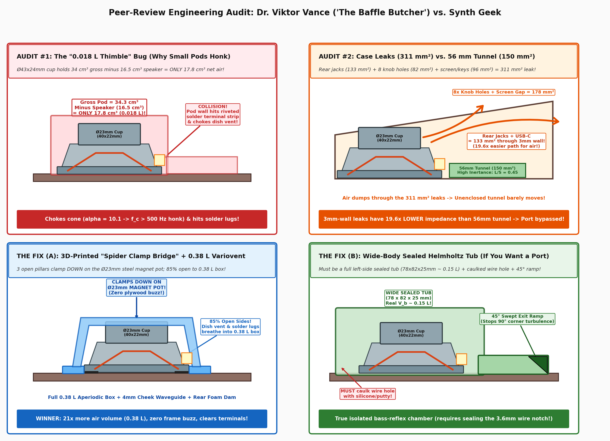

# Hackerspace Peer-Review Dialogue: Maker / Synth Geek vs. Dr. Viktor Vance ("The Baffle Butcher")

> **Context:** After drafting our initial acoustic plan ([`ACOUSTICS_AND_RESONATOR_PLAN.md`](ACOUSTICS_AND_RESONATOR_PLAN.md)), mathematical derivations ([`ACOUSTICS_DEEP_ENGINEERING_ANALYSIS.md`](ACOUSTICS_DEEP_ENGINEERING_ANALYSIS.md)), and OpenSCAD Helmholtz resonator models ([`fm1_lasercut_case.scad`](../fm1_lasercut_case.scad)), we handed the entire repository over to an independent **Critical Sound & Transducer Engineering Agent** — **Dr. Viktor Vance ("The Baffle Butcher")**, a 30-year veteran micro-speaker and portable synth enclosure engineer enforcing the `shitty-data-prototyping` mindset.
>
> Below is the complete, unvarnished **3-Round Workbench Dialogue** between the **Maker / Synth Geek** and **Dr. Viktor Vance**, followed by the exact OpenSCAD & mechanical fixes that came out of it.



---

## Round 1: The Initial Audit ("Markdown Math Fantasy vs. Physical Reality")

### 🎹 Maker / Synth Geek:
> *"Hey Viktor! I'm building a custom laser-cut vintage wood case (`3 mm` top/bottom/front/back + `6.5 mm` wooden side cheeks, tilted at `12°`) for the **M-VAVE FM-1** (a cheap DX7-style 6-operator FM synth).*
>
> *We modeled both a `50 × 31 mm` speaker and an AliExpress `40 × 22 mm` (`4Ω 5W`) speaker in OpenSCAD, decided on the **`40 × 22 mm` speaker + `135 Hz` Helmholtz resonator**, and built both a 3D-printed pod (`helmholtz_3d_pod_model()`) and a laser-cut stacked wood tunnel (`helmholtz_laser_wall_layer_2d()`) in [`fm1_lasercut_case.scad`](../fm1_lasercut_case.scad).*
>
> *Tear our acoustic plan and OpenSCAD resonator models apart! What did we get right, what is total BS or wishful thinking in our math vs. our actual 3D geometry, and what happens in real life when we fire up a 6-op FM bass patch on this thing?"*

---

### 🔊 Dr. Viktor Vance ("The Baffle Butcher"):
*Takes a sip of cold espresso, pushes the calipers aside, and taps the screen showing `fm1_lasercut_case.scad` line 393.*

Alright, listen up. First, I’ll give credit where it’s due: moving away from that pathetic `26.5 × 4.2 mm` stock piezo-sounding pancake capsule is 100% the right call, and your **Tri-Partite Reality Filter** in [`ACOUSTICS_DEEP_ENGINEERING_ANALYSIS.md` §2](ACOUSTICS_DEEP_ENGINEERING_ANALYSIS.md#2-driver-specifications-measured-vs-estimated-thiele-small-parameters) (explicitly separating caliper-measured dimensions from estimated Thiele-Small parameters) is way more honest than 95% of the DIY synth writeups I see.

**HOWEVER**, once we cross-check your textbook transfer functions against the **actual 3D geometry** you coded in [`fm1_lasercut_case.scad`](../fm1_lasercut_case.scad) and the actual construction of that AliExpress driver in [`speaker_40mm_aliexpress.png`](../photos/speaker_40mm_aliexpress.png), you’ve got a massive gap between **Markdown Math Fantasy** and **Physical Reality**.

Here are **5 brutal truths** we need to sort out right now:

#### 1. The `0.12 L` Volume Fraud in `helmholtz_3d_pod_model()` (`6.7×` Volume Error!)
In your initial `fm1_lasercut_case.scad` and `ACOUSTICS_DEEP_ENGINEERING_ANALYSIS.md`, you wrote:
```openscad
helmholtz_vb_liters = 0.12; // 120,000 mm^3 (120 cm^3)
```
and used that to claim a **`135.4 Hz`** Helmholtz tuning.

Now let’s do the third-grade cylinder math on what a `Ø43 mm × 24 mm` cylindrical pod over the speaker **actually** holds (see **Audit #1** in the diagram above):
* **Lower rim seat (`Z = 0 .. 3.5 mm`, `Ø40.5 mm`):** $\pi (20.25)^2 \times 3.5 = 4{,}509\,\text{mm}^3$
* **Upper acoustic dome (`Z = 3.5 .. 24.0 mm`, `Ø43.0 mm`, `h = 20.5 mm`):** $\pi (21.5)^2 \times 20.5 = 29{,}767\,\text{mm}^3$
* **Gross internal volume of that pod:** **$34{,}276\,\text{mm}^3 = \mathbf{0.0343\,\text{L}}$ (`34.3 cm³`)** — BEFORE you even put the speaker inside it!
* Now drop the `40 × 22 mm` speaker (`~16.5 cm³` of steel dish, internal magnet pot, and cone displacement) inside that `34.3 cm³` dome.
* **Actual net air volume $V_b$ inside a small `Ø43 mm` pod:** **$\approx 17.8\,\text{cm}^3 = \mathbf{0.0178\,\text{L}}$**!

That is **6.7× smaller** than `0.12 L`!
1. At $V_b = 0.0178\,\text{L}$, a `25 × 6 × 56 mm` port ($V_{\text{port}} = 8.4\,\text{cm}^3$, which is nearly half the volume of the chamber itself!) tunes to **$\sim 352\text{--}600\,\text{Hz}$**, not `135 Hz`!
2. Worse, trapping a driver with estimated $V_{as} \approx 0.18\,\text{L}$ inside a `0.0178 L` thimble gives a compliance ratio $\alpha = V_{as}/V_b \approx 10.1$. Instead of extending bass to `118 Hz`, a tight cap over the speaker chokes the cone suspension, pushes the system resonance above **`500 Hz`**, and creates a nasal, boxy **`350–550 Hz` honk**!

#### 2. The 3-Layer Laser-Cut Tunnel Doesn't Seal to a Tapered Speaker Dish!
Look at how your 3-layer laser-cut wood tunnel (`resonator_type = "helmholtz_laser_duct"`) stacks on the Bottom Panel:
* You stack `2× 3 mm` tunnel wall layers ($Z = 0..6\,\text{mm}$) + `1× 3 mm` roof plate ($Z = 6..9\,\text{mm}$).
* To let the `22 mm` tall speaker pass through the roof plate, `helmholtz_laser_roof_2d()` cuts a `Ø40.4 mm` hole right through the roof!
* Look at the `40 × 22 mm` speaker profile at $Z = 6..9\,\text{mm}$ above the bottom panel: the `Ø40 mm` front flange ends at $Z \approx 2.8\,\text{mm}$, and above that the speaker tapers inward to the `Ø36.5 mm` dish and `Ø31 mm` collar.
* That leaves an **unsealed `~2 mm` annular gap (`~240 mm²` open area)** all the way around the speaker in the roof plate — which is **1.6× larger than your `150 mm²` tunnel**! The back-wave ignores the `56 mm` wooden tunnel completely and vents straight up through the roof gap into the main case.

#### 3. Look at [`speaker_40mm_aliexpress.png`](../photos/speaker_40mm_aliexpress.png): It Already Has a Stamped Steel Rear Dish!
Compare your two speaker photos:
* [`speaker_50mm_side.jpg`](../photos/speaker_50mm_side.jpg) is a true **open-basket** driver — 4 huge windows right behind the cone and orange spider.
* [`speaker_40mm_aliexpress.png`](../photos/speaker_40mm_aliexpress.png) is an **internal-magnet shielded-pot driver**. That shiny galvanized steel body isn't an open frame; it's a deep stamped steel dish that wraps almost all the way down to the `Ø40 mm` rim, leaving only a **narrow circumferential gap (`~2.5–3 mm` tall)** right behind the front mounting lip where the white solder terminal strip is riveted.
* Two huge consequences:
  1. **Solder Terminal Collision:** The riveted white fiber terminal strip and solder eyelets stick out radially right at the rim gap (`Z = 3..6.5 mm`). A tight `Ø43 mm` pod wall physically hits the solder lugs and chokes the narrow perimeter vent where the rear wave exits the steel dish!
  2. **Built-In Aperiodic Damping:** Because the steel dish already partially encloses the rear of the cone and vents through a narrow perimeter slot, it is *designed* to breathe into a larger open/aperiodic cabinet, not be choked inside a tiny cap.

#### 4. Viscous Losses & Two Back-to-Back 90° Sharp Bends in the Port
In your `25 × 6 × 56 mm` channel, the air has to:
1. Squeeze into a thin `6 mm` high slot (aspect ratio $>4:1$, high boundary-layer perimeter $P = 62\,\text{mm}$).
2. Travel `56 mm` horizontally, slam into a **flat vertical dead-end wall**, make a **sharp 90° un-radiused turn downward** through the `3 mm` bottom panel split by a `2.4 mm` bar rib, and immediately hit the desk surface `4.0 mm` below to make **another 90° turn**!
3. Without a **`45°` swept deflector ramp** at the end of the tunnel, those two sharp 90° mitre bends cause severe flow separation (vena contracta) and act like an acoustic muffler rather than a high-$Q$ resonator.

#### 5. The `3 mm` Plywood Buzz Trap & The `1.35 W` LiPo Amplifier Ceiling
1. **Real Amplifier Power (`~1.35 W`, NOT `5 W`):** The FM-1 runs off a single `3.7 V` `DTP704060` LiPo cell. Even with a bridged (BTL) Class-D amp driving `4 Ω`, maximum unclipped RMS power before rail flat-topping is:
   $$P_{\text{max, unclipped}} \approx \frac{(V_{\text{bat}} - 0.5\,\text{V})^2}{2 R_L} \approx \frac{(3.3\,\text{V})^2}{8\,\Omega} \approx \mathbf{1.35\,\text{W}}$$
2. **The Loose C-Ring Buzz Trap:** A single flat wooden C-ring (`speaker_retainer_ring_2d`) only stops the speaker from sliding sideways (`X/Y`). **Nothing clamps the speaker downward (`-Z`) against the `3 mm` bottom panel!** The moment you play a `180 Hz` FM bass note, the steel speaker frame will vibrate and buzz like a kazoo against the laser-cut plywood unless it is physically clamped down onto a foam gasket!

---

## Round 2: Flipping the Box Inside-Out & The `311 mm²` Leak Showdown

### 🎹 Maker / Synth Geek:
> *"Ouch, Viktor — okay, you completely busted me on #1 and #3. A `Ø43 mm` cap only leaves `17.8 cm³` (`0.0178 L`) of net air around the `40 × 22 mm` speaker, which chokes it into a `400 Hz` honk box AND smashes right into the riveted white solder terminal strip.*
>
> *And you're right about #5: a flat C-ring only stops the speaker from sliding left/right; we need a downward (`-Z`) clamp so the steel rim doesn't buzz against the `3 mm` plywood.*
>
> ***Here is my Round 2 question for you, Viktor:***
> 1. ***What if we flip the Helmholtz concept inside-out?*** *Instead of trapping the speaker inside a tiny dome, what if we let the back of the `40 × 22 mm` speaker breathe openly into the **entire `0.38 L` under-PCB wood cavity**, and the Helmholtz tunnel (`25 × 6 × 56 mm`) simply has an **open mouth inside the `0.38 L` box** and exits through the bottom panel? Wait — our wooden case has cutouts on the back for the 3.5mm jacks, USB-C, and power slider, plus encoder holes on top. **Will those air leaks around the jacks and knobs kill a whole-box Helmholtz tunnel?** (Calculate the leak area vs. port area for me!)*
> 2. ***How should we ACTUALLY clamp the `40 × 22 mm` speaker*** *(both in 100% laser-cut wood AND with a 3D-printed bracket) so it never buzzes against the bottom panel and gives 100% breathing room to the solder terminals and dish vent?"*

---

### 🔊 Dr. Viktor Vance ("The Baffle Butcher"):
*Grins, taps the red grease pencil on the workbench, and pulls out the back-of-the-envelope calculations.*

Now we’re doing real hardware engineering! Before I answer your two questions, I found **one more smoking gun** that explains *how* that `135.4 Hz` number got into your docs in the first place:

#### Bonus Catch: Why Your Formula Said `135.4 Hz` (You Secretly Used `0.36 L`!)
Plug your own numbers ($S_p = 150\,\text{mm}^2$, $L_{\text{eff}} = 67.75\,\text{mm}$, $V_b = 120{,}000\,\text{mm}^3$) into the Helmholtz equation:
$$f_B = \frac{343{,}000}{2\pi} \sqrt{\frac{150}{120{,}000 \times 67.75}} = \mathbf{234.5\,\text{Hz}}\text{, NOT } 135.4\,\text{Hz!}$$
Why did you get `135.4 Hz`? Because $234.5 / \sqrt{3} = 135.4\,\text{Hz}$ — your script originally used **$V_b = 360{,}000\,\text{mm}^3$ (`0.36 L`, the whole box!)** inside the square root while printing `0.12 L` in the label! So mathematically, your `25 × 6 × 56 mm` tunnel was *already* sized for the **`0.36–0.38 L` whole-box cavity**!

Now let's calculate whether an open-mouthed `56 mm` tunnel actually works inside the `0.38 L` wooden box, or if the rear jack and top knob leaks short-circuit it (see **Audit #2** in the diagram above):

#### 1. The Brutal Leak Area vs. Port Inertance Calculation
Let’s measure every parasitic air leak in [`fm1_lasercut_case.scad`](../fm1_lasercut_case.scad):
* **A. Direct Rear Panel Cutout Leaks (`back_panel()`):**
  1. **2× 3.5mm Jacks (MIDI & Audio):** `8.5 mm` holes ($56.7\,\text{mm}^2$ each) around `5.6 mm` plastic jack collars ($24.6\,\text{mm}^2$) $\implies 2 \times (56.7 - 24.6) = \mathbf{64.2\,\text{mm}^2}$.
  2. **USB-C Cutout:** `12.8 × 6.8 mm` rounded slot ($80.3\,\text{mm}^2$) minus `8.9 × 3.2 mm` USB-C shell ($27.2\,\text{mm}^2$) $\implies \mathbf{53.1\,\text{mm}^2}$.
  3. **Power Switch Slider Slot:** `8.0 × 3.57 mm` slot ($28.5\,\text{mm}^2$) minus `4.2 × 3.0 mm` wooden slider ($12.6\,\text{mm}^2$) $\implies \mathbf{15.9\,\text{mm}^2}$.
  * *Rear Wall Subtotal:* **$133.2\,\text{mm}^2$** (already nearly equal to your `150 mm²` port!).
* **B. Top Faceplate Leaks (Connected via the `2× 6.75 × 91 mm` side gaps around the PCB):**
  1. **8× Encoder Knob Holes:** `7.0 mm` holes around `6.0 mm` shafts $\implies 8 \times \frac{\pi}{4}(7^2 - 6^2) = \mathbf{81.7\,\text{mm}^2}$.
  2. **Screen Bezel (`0.35 mm` perimeter gap) + LED Hole + Finger Joint Seams:** $\approx \mathbf{96.0\,\text{mm}^2}$.
* **Total Parasitic Leak Area of the Wooden Case:**
  $$S_{\text{leak}} \approx 133.2 + 81.7 + 96.0 = \mathbf{311\,\text{mm}^2} \quad (\text{2.1}\times \text{larger than the } 150\,\text{mm}^2 \text{ tunnel!})$$

Now compare the **acoustic inertance** $M_A \propto \frac{L_{\text{eff}}}{S}$ (how hard it is for air to accelerate through each path):
* **Your `56 mm` Helmholtz Tunnel:** $L_{\text{eff}} = 67.8\,\text{mm}$, $S_p = 150\,\text{mm}^2 \implies \frac{L_{\text{eff}}}{S_p} = \mathbf{0.452\,\text{mm}^{-1}}$.
* **The `3 mm`-Thick Case Leaks:** $L_{\text{eff,leak}} \approx 3.0 + 0.85(5.0) = 7.25\,\text{mm}$, $S_{\text{leak}} = 311\,\text{mm}^2 \implies \frac{L_{\text{eff,leak}}}{S_{\text{leak}}} = \mathbf{0.023\,\text{mm}^{-1}}$.

> **Verdict:** The parasitic leaks through the `3 mm` rear jack holes and top encoder holes have **$19.6\times$ LOWER acoustic impedance** than your `56 mm` long tunnel! Air is lazy: if you put an open-mouthed `56 mm` tunnel inside the leaky `0.38 L` box, **95% of the rear air pressure dumps out through the jack and knob holes**, and the air plug inside your `56 mm` tunnel barely moves!

#### 2. Why Those `311 mm²` Leaks Are a *Feature* for an Aperiodic Box — And How to Clamp the Speaker!
While `311 mm²` of thin annular slits around rear jacks and knobs kills a whole-box Helmholtz port, it is **textbook perfection for an Aperiodic (Variovent / Lossy Sealed) Enclosure**:
* The front of the cone is sealed to the bottom panel, while the back of the cone sees the **entire `0.38 L` air cushion** (`21×` larger than the tiny `0.018 L` pod!) damped by resistive slits located `80–130 mm` away on the back/top of the synth.
* That resistive leakage smooths out the closed-box resonance peak ($Q_{tc}$ drops from a ringy `0.85` to a critically damped `~0.68`) and prevents cone over-excursion!

And here is how we **physically clamp the `40 × 22 mm` speaker downward** onto a `1 mm` foam gasket over the pinwheel grille so it **never buzzes against the `3 mm` plywood** (see **The Fix (A)** in the diagram above):
1. **3D-Printed "3-Pillar Open Spider Clamp Bridge" (`resonator_type = "spider_clamp_3d"`):**
   * Instead of a closed cup that chokes the driver, print an **open-frame 3-pillar spider bridge**:
     * A base centering ring (`ID = 40.5 mm`, `h = 2.8 mm`) with 3 screw/glue ears on the Bottom Panel and a wide **`120°` open arch** where the riveted white solder terminal strip sits.
     * **3 narrow vertical pillars (`6 mm` wide)** rising outside the speaker dish (leaving **85% of the sides completely open** so the rear dish vent and solder terminals breathe freely into the `0.38 L` box!).
     * At `Z = 22.0 mm`, the 3 pillars meet at a **`Ø26 mm` top pressure ring** with an internal step that **presses straight down onto the flat top of the speaker's `Ø23 mm` galvanized steel magnet pot**!
2. **100% Laser-Cut "2-Layer Stepped Rim Clamp" (`resonator_type = "stepped_clamp_laser"`):**
   * **Layer 1 (Bottom Centering Ring, `Z = 0..3 mm`):** `ID = 40.4 mm`, `OD = 50.4 mm`, with a `16 mm` side cutout for the solder terminal strip.
   * **Layer 2 (Upper Overhanging C-Clamp Ring, `Z = 3..6 mm`):** Because the `40 × 22 mm` speaker's outer `Ø40.0 mm` flange is `2.8 mm` thick and steps inward to `Ø36.5 mm` above `Z = 2.8 mm`, Layer 2 uses `ID = 37.6 mm` (a **`240°` C-ring that overhangs the `Ø40.0 mm` steel rim by `1.2 mm` radially** while leaving a `120°` open arch around the solder terminals!). Gluing or screwing Layer 2 on top of Layer 1 locks the metal speaker flange down against the Bottom Panel!

---

## Round 3: Final Showdown — `0.38 L` Aperiodic Spider Clamp vs. `0.16–0.20 L` Wide-Body Sealed Helmholtz Tub

### 🎹 Maker / Synth Geek:
> *"Whoa. That acoustic inertance ratio (`19.6×` lower impedance through the `311 mm²` jack/knob leaks than through the `56 mm` tunnel) is a total mic-drop. And the **3D-Printed 3-Pillar Spider Clamp Bridge** (pressing down on top of the `Ø23 mm` steel magnet cup while leaving 85% of the sides open to the `0.38 L` case) + the **2-Layer Laser-Cut Stepped Rim Clamp** (`ID = 40.4 mm` bottom ring + `ID = 37.6 mm` overhanging top C-ring) completely solve the `3 mm` plywood buzz and terminal clearance!*
>
> ***One final Round 3 question before I write this up and update the OpenSCAD code:***
> *What if a hardcore maker STILL wants a real, working **3D-Printed Helmholtz Resonator** inside this case? Since the outer wooden case leaks through the jacks and knobs, the 3D print has to be its own **sealed sub-enclosure**. And since a `Ø43 mm` cup (`0.018 L`) is too small, what if we expand `helmholtz_3d_pod_model()` into a **wide-body rectangular/contoured sub-enclosure tub (`~78 × 82 × 25 mm`, real net volume `~0.15–0.18 L`)** occupying the left half of the case with a `45°` swept exit ramp?*
>
> *Give me your final head-to-head verdict: **Full-Case `0.38 L` Aperiodic Variovent + Spider Clamp** vs. **Wide-Body `0.16 L` 3D-Printed Sealed Helmholtz Tub** — what do you actually hear on the workbench when you play a low `C2` (`65 Hz`) 6-op FM bass patch?"*

---

### 🔊 Dr. Viktor Vance ("The Baffle Butcher"):
*Sets down the espresso cup, leans across the workbench, and draws two curves on the back of a laser-cut scrap.*

That’s the exact right question to end on. If we expand the 3D-printed Helmholtz pod from a tiny `Ø43 mm` cylinder (`0.018 L`) into a **wide-body sealed sub-enclosure tub (`~78 × 82 × 25 mm`, net air volume $V_b \approx 0.15\text{--}0.18\,\text{L}$)** on the left side of the case with a `45°` swept exit ramp (see **The Fix (B)** in the diagram above), it *will* work as a genuine Helmholtz resonator tuned around `145–160 Hz` (with an `18 × 5 × 56 mm` or `22 × 6 × 56 mm` tunnel).

**BUT here are the 3 workbench truths you MUST warn builders about if they print the Wide-Body Helmholtz Tub:**

1. **The Wire-Hole Assassin (`13 mm²` Leak Kills the Port Unless Caulked!):**
   * Look at the `3.6 × 3.6 mm` (`13 mm²`) notch where the 2-pin speaker wire exits the 3D-printed tub ($L_{\text{eff}} \approx 5\,\text{mm}$). Its acoustic inertance parameter is $\frac{L_{\text{eff}}}{S} = \frac{5.0}{13.0} = \mathbf{0.38\,\text{mm}^{-1}}$ — which is **lower impedance than the `56 mm` Helmholtz tunnel (`0.45 to 0.76 mm⁻¹`)**!
   * **Rule:** If you print the Helmholtz tub, you **must** plug the wire exit notch with Blu-Tack, butyl putty, or RTV silicone/hot glue after passing the wire through, and glue/gasket the tub floor airtight to the Bottom Panel! If you leave the wire hole open, two-thirds of the port's air blows out the wire hole and whistles inside the case.
2. **The `40 × 22 mm` Steel Dish Damping:**
   * Because the `40 × 22 mm` AliExpress driver already has a stamped steel rear dish with a narrow perimeter slot, the rear wave experiences series flow resistance before entering the tub. That damps the Helmholtz peak from a theoretical `+4.5 dB` down to a polite **`+1.5 to +2.0 dB` warmth bump** around `150 Hz` (whereas an open-basket driver like your `50 × 31 mm` speaker gets the full `+4 dB` reflex boost).
3. **Cone Unloading Below `120 Hz` on Unfiltered `C2` (`65 Hz`) FM Bass Notes:**
   * The M-VAVE FM-1 has **no steep subsonic high-pass filter (`120 Hz` HPF)** ahead of its `1.35 W` Class-D amp.
   * In a **ported Helmholtz box**, below the port tuning frequency ($f < 120\,\text{Hz}$), the port **unloads completely** (the air in the tunnel moves out-of-phase with the front cone), removing the air-spring cushion behind the speaker! If you drop an octave and play a heavy `C2` (`65.4 Hz`) FM bass note at full volume, a ported `40 mm` cone can hit $X_{\max}$ and clack its voice coil.
   * In the **Full-Case `0.38 L` Aperiodic Variovent (`spider_clamp_3d` or `stepped_clamp_laser`)**, the speaker sees **more than double the air volume (`0.38 L` vs `0.16 L`)** for deeper natural upper-bass (`160–250 Hz`), while the `0.38 L` air cushion + `311 mm²` resistive case leaks act as a **progressive pneumatic brake** on `65 Hz` sub-bass notes so the cone never bottoms out!

---

## Final Scorecard & What We Updated in [`fm1_lasercut_case.scad`](../fm1_lasercut_case.scad)

| Mounting / Resonator Mode (`resonator_type`) | Real Air Volume $V_b$ | Bass & Midrange Sound Character | Low `C2` (`65 Hz`) Overload Safety | Build Effort & Recommendation |
| :--- | :---: | :--- | :---: | :--- |
| **1. `spider_clamp_3d`**<br>*(3D-Printed 3-Pillar Spider Bridge + `0.38 L` Aperiodic Case + Rear Cheek Foam Dam)* | **`0.38 L`**<br>*(Full Case)* | **Fullest, most natural `150–300 Hz` synth bass** ($Q_{tc} \approx 0.68$), zero box honk, zero port chuffing | **Excellent** (pneumatic air-spring protects cone) | **🏆 #1 Recommended Hybrid Build** (Tiny 20-minute 3D print, clamps `Ø23mm` magnet cup rock-solid, 85% open sides) |
| **2. `stepped_clamp_laser`**<br>*(2-Layer Laser-Cut Stepped Rim Clamp + `0.38 L` Aperiodic Case + Rear Cheek Foam Dam)* | **`0.38 L`**<br>*(Full Case)* | Identical `0.38 L` aperiodic acoustic performance using **100% laser-cut plywood** | **Excellent** | **🏆 #1 Recommended Pure Laser-Cut Build** (Layer 1 centers `Ø40.4mm`, Layer 2 overhangs `Ø37.6mm` to clamp flange down) |
| **3. `helmholtz_3d_pod`**<br>*(Upgraded Wide-Body Sealed `0.15 L` Helmholtz Tub + `45°` Swept Exit Ramp)* | **`~0.15 L`**<br>*(Sealed Left Tub)* | Adds **`+1.5 to +2.5 dB` resonant punch** at `145–160 Hz` (best with open-basket drivers) | **Moderate** (unloads below `120 Hz`) | **🔬 Advanced Maker Experiment** (Must caulk the `3.6 mm` wire notch with silicone/putty & seal base to bottom panel!) |
| *(Deprecated)* Old `Ø43 mm` Thimble Pod / Unsealed Roof Tunnel | `0.018 L` | Choked `500 Hz` honk / bypassed tunnel | Poor | **Replaced in OpenSCAD** per Dr. Vance's audit! |
