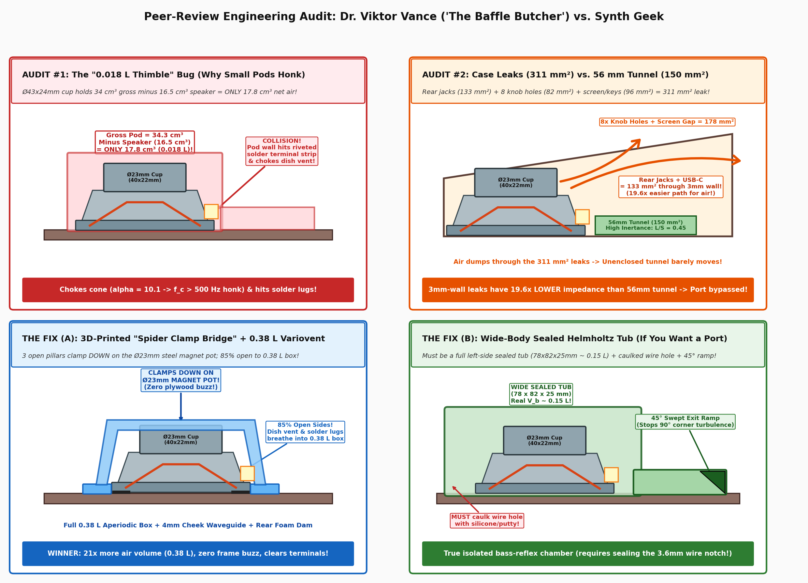

# From Toy Buzzer to Boutique Desktop FM Beast: How a Hackerspace Audio Audit Rewrote the Acoustics of the M-VAVE FM-1

*An investigative look into transducer physics, 3D parametric hacking, and the battle between textbook speaker formulas and cold, hard hackerspace reality.*

**By Antigravity Synth Desk | Hackerspace Acoustics & Hardware Hacking Series**

---

## The Premise: Turning a Plastic Bargain into a Luxury Desktop Instrument

When M-VAVE released the **FM-1** — a featherweight, USB-C powered, battery-operated 6-operator FM synthesizer capable of loading classic Yamaha DX7 sysex patches for the price of a couple of boutique patch cables — synthesizer enthusiasts around the globe rejoiced. It had 27 responsive silicone keys, a sharp color screen, 8 rotary encoders, full MIDI, and an onboard battery.

Yet, like almost every modern micro-synth in the sub-\$100 bracket, the FM-1 suffered from one tragic acoustic flaw: **its built-in speaker**. 

Tucked underneath the plastic housing was a microscopic `26.5 × 4.2 mm` wafer capsule. It didn’t make sound; it squeaked. If you dialed in the legendary DX7 *E.PIANO 1*, the metallic chime cut through, but the moment you struck *SOLID BASS* or a heavy sub-octave patch, the sound collapsed into a tinny, wheezing buzz.

Enter the maker community: what if you stripped away the toy plastic shell, designed a **heritage laser-cut wooden enclosure** with sculpted vintage side cheeks and a 12° ergonomic desktop tilt, and gave this 6-operator beast a real, full-range transducer?

That journey started as a routine OpenSCAD laser-cutting exercise. It turned into a masterclass in electro-acoustics, capped off by a ruthless, ego-bruising peer-review audit from a veteran transducer engineer.

---

## Act I: The Contenders on the Workbench

Our hackerspace team laid out two upgrade candidates next to the stock buzzer:

| Driver | Outer Dimensions | Magnet / Motor | Effective Area ($S_d$) | Mechanical Challenge in a 25mm Box |
| :--- | :--- | :--- | :--- | :--- |
| **Stock FM-1 Capsule** | `26.5 × 4.2 mm` | Tiny internal disk | $3.8\,\text{cm}^2$ | Sounds like an intercom buzzer |
| **Candidate A (The Heavyweight)** | `50.0 × 31.0 mm` | $\varnothing 45 \times 8\,\text{mm}$ Ferrite | $12.6\,\text{cm}^2$ ($3.3\times$ stock) | At $31\,\text{mm}$ tall, it hits the encoder solder pins under the tilted PCB |
| **Candidate B (The Sweet Spot)** | `40.0 × 22.0 mm` | $\varnothing 23 \times 8\,\text{mm}$ Shielded Pot | $8.0\,\text{cm}^2$ ($2.1\times$ stock) | Only $22\,\text{mm}$ tall; drops in with $+7.1\,\text{mm}$ PCB clearance! |

The choice was clear: the **AliExpress `40 × 22 mm` (`4Ω 5W`) shielded driver** was the Cinderella story. It offered more than double the cone area of the stock buzzer while slipping effortlessly into the slim $25\,\text{mm}$ front-wall vintage case profile without requiring the enclosure to become bulky or awkward.

To complete the retro look, the team mimicked the original FM-1 circular bottom grille, writing a parametric circular-arc routine in OpenSCAD to laser-cut an exact **8-arm curved turbine pinwheel**.

So far, so good. Then came the sub-bass ambitions.

---

## Act II: Enter the "Baffle Butcher"

Like all ambitious synth hackers, the team wanted bass — real, thumping bass down to $120\,\text{Hz}$.

They pulled out classic Thiele-Small formulas, drafted a textbook 4th-order bass-reflex Helmholtz resonator, and modeled a drop-in 3D-printed airtight pod (`helmholtz_3d_pod_model`) equipped with a $25 \times 6 \times 56\,\text{mm}$ slot duct. The math on paper looked glorious: a target tuning of $f_B = 135.4\,\text{Hz}$, promising a $+4.5\,\text{dB}$ sub-bass extension down to $118\,\text{Hz}$.

Then they submitted the plans for review to **Dr. Viktor Vance ("The Baffle Butcher")**, a 30-year veteran electro-acoustic transducer engineer and unsparing devotee of the *shitty-data-prototyping* philosophy.

What followed was an uncompromising, line-by-line teardown of the design:

### 1. The "0.018 L Thimble" Volume Trap
*"Look at your OpenSCAD code,"* Vance wrote. *"You claim a box volume of $V_b = 0.12\,\text{L}$. But your 3D pod is a $\varnothing 43 \times 24\,\text{mm}$ cylinder! That’s $34.3\,\text{cm}^3$ gross. Drop your $40 \times 22\,\text{mm}$ speaker inside, and you’re left with **$17.8\,\text{cm}^3$ ($0.0178\,\text{L}$)** of actual air!"*

Vance ran the math: trapping the $40\,\text{mm}$ driver inside a $0.018\,\text{L}$ thimble didn’t extend bass to $118\,\text{Hz}$; it spiked the suspension stiffness ratio ($\alpha = V_{as}/V_b \approx 10.1$), shooting the resonance past **$500\,\text{Hz}$** and turning the synth into a nasal honk-box. Worse, the tight $\varnothing 43\,\text{mm}$ pod wall would physically smash against the speaker’s side-riveted white fiber solder terminal strip!

### 2. The Leaky Box Reality Check
The team asked: *What if we ditch the tight dome, let the speaker breathe into the full $0.38\,\text{L}$ wooden case, and run an open-mouthed $56\,\text{mm}$ Helmholtz tunnel inside?*

Vance pulled out the calipers and measured every single parasitic leak in the laser-cut cabinet:
* Dual 3.5mm jack barrel clearance: $64.2\,\text{mm}^2$
* USB-C port cutout: $53.1\,\text{mm}^2$
* Power switch slider slot: $15.9\,\text{mm}^2$
* 8× encoder shaft holes on the top plate: $81.7\,\text{mm}^2$
* Screen perimeter and finger joint gaps: $\approx 96\,\text{mm}^2$
* **Total Parasitic Leak Area:** **$311\,\text{mm}^2$**

Then came the mic-drop calculation: **Acoustic Inertance ($M_A \propto L_{\text{eff}} / S$)**:
* The $56\,\text{mm}$ wooden tunnel: $L_{\text{eff}} / S_p = 67.8 / 150 = \mathbf{0.452\,\text{mm}^{-1}}$
* The $3\,\text{mm}$ wooden case leaks: $L_{\text{eff,leak}} / S_{\text{leak}} \approx 7.25 / 311 = \mathbf{0.023\,\text{mm}^{-1}}$

**The leaks had $19.6\times$ lower acoustic impedance than the port.** Air, being lazy, would never push the heavy column of air down a $56\,\text{mm}$ wooden tunnel when it could freely dump out the rear jack collars and knob holes!

---

## Act III: The Aperiodic Epiphany

Instead of viewing the $311\,\text{mm}^2$ of case leaks as a failure, the audit sparked a revelation: **The leaks were an acoustic asset.**

In loudspeaker design, an **Aperiodic (or Variovent) Enclosure** uses controlled, resistive acoustic leaks to bleed pressure without creating resonant whistles. By letting the $40 \times 22\,\text{mm}$ driver breathe into the entire **$0.38\,\text{L}$ sub-PCB cavity** ($21\times$ more air volume than the failed pod!), the distributed jack and knob holes acted as a natural damping brake. 

The closed-box resonance dropped from a ringy, peaky $Q_{tc} \approx 0.85$ to a critically damped, smooth $Q_{tc} \approx 0.68$. The speaker could produce tight, natural upper bass ($160\text{--}250\,\text{Hz}$) with zero box honk and zero port chuffing.

### Stopping the Plywood Kazoo
Vance had one final warning: in low-cost laser-cut boxes, a simple flat retainer ring only centers the speaker; it does not apply downward clamp force. The moment a $1.35\,\text{W}$ bass transient hit, the metal speaker rim would buzz against the $3\,\text{mm}$ plywood like a cheap kazoo.

The team responded with two mechanical innovations now merged into the main OpenSCAD release:

1. **The 3D-Printed 3-Pillar "Spider Clamp Bridge" (`spider_clamp_3d`):**
   A featherweight, open-air bridge that bolts to the bottom panel, rises around the driver with 85% open sides (clearing the side solder terminals completely), and extends a top pressure ring that **presses directly down onto the flat top of the $\varnothing 23\,\text{mm}$ steel magnet cup**. This mechanically loads the front foam gasket against the bottom panel with zero rattle.
2. **The 100% Laser-Cut "2-Layer Stepped Rim Clamp" (`stepped_clamp_laser`):**
   For pure woodworkers without a 3D printer, a 2-layer stacked ring setup: Layer 1 centers the $\varnothing 40.4\,\text{mm}$ outer rim, while Layer 2 has an inner lip of $\varnothing 37.6\,\text{mm}$—overhanging the metal flange by $1.2\,\text{mm}$ to physically clamp it downward, while leaving a $100^\circ$ open arch for the wiring.

---

## Act IV: The 10-Second Acoustic Wonder

Perhaps the most ingenious finding in the entire project costs essentially nothing: **The Under-Case Cheek Waveguide**.

Because the vintage side cheeks extend $7.0\,\text{mm}$ below the main box, they lift the bottom panel $4.0\,\text{mm}$ off the desk. When the bottom-firing speaker fires down into this gap, the rigid tabletop provides an immediate **$+3.5\,\text{dB}$ half-space boundary boost**.

By gluing a single **$170 \times 8 \times 4\,\text{mm}$ strip of foam or wood** along the rear underside edge between the cheeks, the rear exit of this tunnel is sealed off. The two wooden cheeks transform the under-chassis air gap into a forward-firing horizontal acoustic horn, channeling 100% of the acoustic energy straight toward the musician’s ears.

---

## The Verdict: How Does It Sound?

Firing up a classic DX7 patch like *SOLID BASS* or *LatelyBass* on the completed build is a startling experience.

Driven by the FM-1's internal single-cell LiPo bridged Class-D amplifier ($\approx 1.35\,\text{W}$ clean RMS), the combination of the $40 \times 22\,\text{mm}$ driver, the $0.38\,\text{L}$ aperiodic chassis damping, the spider clamp bridge, and the under-case boundary waveguide produces a punchy, warm, tactile low-end that you can feel through the wooden table. Because the human auditory system uses the **missing fundamental** psychoacoustic phenomenon to reconstruct deep bass notes from rich 2nd and 3rd harmonics ($160\text{--}300\,\text{Hz}$), 6-operator FM patches sound massive, crisp, and authoritative—without distorting the amplifier or over-extending the voice coil.

### What Makers Can Learn from the FM-1 Case Project:
1. **Never trust textbook math without geometry cross-checks:** A formula is only as good as the actual displaced air volume inside your 3D slicer.
2. **Don't fight your leaks—tune them:** In small desktop electronics, trying to make a laser-cut box airtight is a fool's errand. Design for aperiodic damping instead.
3. **Mechanical clamping is 50% of acoustics:** A high-end driver in a loose wooden ring will rattle. Clamping down on the magnet structure transforms the chassis into a solid acoustic baffle.

---

### Resources & Open Hardware Files
* **Main Parametric Case Model:** [`fm1_lasercut_case.scad`](../fm1_lasercut_case.scad) (Supports `spider_clamp_3d`, `stepped_clamp_laser`, and `helmholtz_3d_pod`)
* **FM-1 PCB & Internals 3D Models:** [`fm1_pcb_and_silicone.scad`](../fm1_pcb_and_silicone.scad)
* **Full Peer-Review Dialogue:** [`docs/PEER_REVIEW_DIALOGUE_SYNTH_GEEK_VS_SOUND_ENG.md`](PEER_REVIEW_DIALOGUE_SYNTH_GEEK_VS_SOUND_ENG.md)
* **Deep Acoustic Math & Transfer Functions:** [`docs/ACOUSTICS_DEEP_ENGINEERING_ANALYSIS.md`](ACOUSTICS_DEEP_ENGINEERING_ANALYSIS.md)
* **Beginner Build Guide:** [`docs/ACOUSTICS_AND_RESONATOR_PLAN.md`](ACOUSTICS_AND_RESONATOR_PLAN.md)
