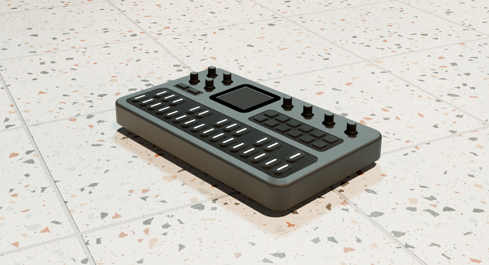

# Downloaded Reference Material (`M-VAVE FM-1`)

This folder contains the external reference files used to reverse-engineer and design the laser-cut enclosure:

## 1. [`3d_model_grabcad/`](3d_model_grabcad/) — 3D Scan & CAD Reference
* **Source:** [**M-Vave FM-1 by Zande Creates on GrabCAD**](https://grabcad.com/library/m-vave-fm-1-1)
* Created from a **Revopoint 3D scan** and caliper measurements of the stock M-VAVE FM-1 (`162.0 × 97.0 mm` enclosure footprint).
* **Note:** Because `FM1.obj` (`177 MB`) and `FM1.stp` (`19.7 MB`) are large 3D CAD/mesh files, they are excluded via [`.gitignore`](../.gitignore) and can be downloaded directly from the GrabCAD link above.

---

## 2. [`official_cuvave/`](official_cuvave/) — Official Product Manual & Images
* **Source:** [**Cuvave / M-VAVE FM-1 Official Product Page**](https://www.cuvave.com/product?id=fm-1)
* Contains the official PDF manual ([`FM-1-manual.pdf`](official_cuvave/FM-1-manual.pdf)) and product photos (`fm-1-1.webp`–`fm-1-6.webp`).
